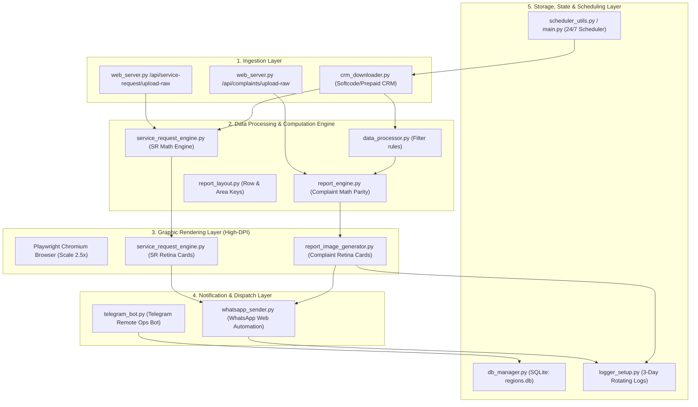

# Master Codebase Wiring, Architecture & Ripple-Impact Blueprint

> **Auto-Generated Verification Document**  
> **Last Code Synchronization**: `2026-10-15 20:37:20`  
> **Analyzed Modules**: `42 Python Files` | `411 Symbols` | `63 REST Endpoints`  

---

## 1. System High-Level Topology & Data Pipelines

The repository operates across 5 decoupled operational layers:



---

## 2. Core Modules: Detailed Line-by-Line Wiring & Call Mapping

### `config.py`

| Symbol | Type | Line Span | Primary Responsibility | Downstream Calls | Direct Callers |
| :--- | :--- | :--- | :--- | :--- | :--- |
| [`_load_region_config`](file:///C:/Users/Anoop P/Antigravity/Daily Work Flow/config.py#L12-L35) | function | `L12-L35` | Load the installation-specific region configuration from JSON. | `13` callee(s) | 0 (Entrypoint) |
| [`get_adl_export_query`](file:///C:/Users/Anoop P/Antigravity/Daily Work Flow/config.py#L126-L142) | function | `L126-L142` | Generates the Softcode CRMS SQL export query for ADL Broadband for a specific region. | `2` callee(s) | `3` caller(s) |
| [`get_adl_service_request_export_query`](file:///C:/Users/Anoop P/Antigravity/Daily Work Flow/config.py#L161-L179) | function | `L161-L179` | Return the ADL Service Request export defined by the operations team. | `2` callee(s) | `1` caller(s) |
| [`get_adtv_export_query`](file:///C:/Users/Anoop P/Antigravity/Daily Work Flow/config.py#L144-L158) | function | `L144-L158` | Generates the Softcode CRMS SQL export query for ADTv Digital TV for a specific region. | `2` callee(s) | `3` caller(s) |
| [`get_adtv_service_request_export_query`](file:///C:/Users/Anoop P/Antigravity/Daily Work Flow/config.py#L182-L197) | function | `L182-L197` | Return the ADTv Service Request export defined by the operations team. | `2` callee(s) | `1` caller(s) |
| [`resolve_target_excel_path`](file:///C:/Users/Anoop P/Antigravity/Daily Work Flow/config.py#L63-L105) | function | `L63-L105` | Robustly resolves a valid, existing Excel master workbook path. | `9` callee(s) | `7` caller(s) |

### `crm_downloader.py`

| Symbol | Type | Line Span | Primary Responsibility | Downstream Calls | Direct Callers |
| :--- | :--- | :--- | :--- | :--- | :--- |
| [`_read_prepaid_export`](file:///C:/Users/Anoop P/Antigravity/Daily Work Flow/crm_downloader.py#L398-L404) | function | `L398-L404` | Read the SMS export whether its server labels it CSV or Excel. | `4` callee(s) | `1` caller(s) |
| [`cleanup_old_download_files`](file:///C:/Users/Anoop P/Antigravity/Daily Work Flow/crm_downloader.py#L43-L79) | function | `L43-L79` | Cleans up raw downloaded Excel / CSV files older than `hours` (default 24h). | `10` callee(s) | `1` caller(s) |
| [`download_from_crm`](file:///C:/Users/Anoop P/Antigravity/Daily Work Flow/crm_downloader.py#L499-L575) | function | `L499-L575` | Unified entrypoint: | `10` callee(s) | `5` caller(s) |
| [`download_service_requests_from_crm`](file:///C:/Users/Anoop P/Antigravity/Daily Work Flow/crm_downloader.py#L407-L496) | function | `L407-L496` | Download the three current Service Request sources and save one private, | `18` callee(s) | `7` caller(s) |
| [`download_via_http_session`](file:///C:/Users/Anoop P/Antigravity/Daily Work Flow/crm_downloader.py#L110-L260) | function | `L110-L260` | Direct, ultra-fast headless HTTP session downloader for Softcode and Prepaid portals. | `15` callee(s) | `2` caller(s) |
| [`download_via_playwright`](file:///C:/Users/Anoop P/Antigravity/Daily Work Flow/crm_downloader.py#L263-L395) | function | `L263-L395` | Playwright browser automation fallback. | `23` callee(s) | `2` caller(s) |
| [`find_latest_file`](file:///C:/Users/Anoop P/Antigravity/Daily Work Flow/crm_downloader.py#L82-L87) | function | `L82-L87` | Finds the most recently modified file matching pattern in directory. | `4` callee(s) | `1` caller(s) |
| [`get_latest_local_downloads`](file:///C:/Users/Anoop P/Antigravity/Daily Work Flow/crm_downloader.py#L90-L104) | function | `L90-L104` | Checks data and downloads directories for existing latest pending complaint files. | `2` callee(s) | `2` caller(s) |

### `data_processor.py`

| Symbol | Type | Line Span | Primary Responsibility | Downstream Calls | Direct Callers |
| :--- | :--- | :--- | :--- | :--- | :--- |
| [`_casefold_eq`](file:///C:/Users/Anoop P/Antigravity/Daily Work Flow/data_processor.py#L41-L42) | function | `L41-L42` | — | `3` callee(s) | `3` caller(s) |
| [`_casefold_in`](file:///C:/Users/Anoop P/Antigravity/Daily Work Flow/data_processor.py#L60-L62) | function | `L60-L62` | — | `5` callee(s) | `1` caller(s) |
| [`_filter_configured_centers`](file:///C:/Users/Anoop P/Antigravity/Daily Work Flow/data_processor.py#L65-L123) | function | `L65-L123` | Keep only source keys explicitly mapped to the selected region. | `14` callee(s) | `3` caller(s) |
| [`_find_column`](file:///C:/Users/Anoop P/Antigravity/Daily Work Flow/data_processor.py#L54-L57) | function | `L54-L57` | Find a portal column despite harmless header case/space differences. | `4` callee(s) | `3` caller(s) |
| [`compute_all_sections`](file:///C:/Users/Anoop P/Antigravity/Daily Work Flow/data_processor.py#L185-L189) | function | `L185-L189` | Backward-compatible wrapper: final 'Post Paid & Prepaid' tables as DataFrames. | `3` callee(s) | `1` caller(s) |
| [`compute_report_result`](file:///C:/Users/Anoop P/Antigravity/Daily Work Flow/data_processor.py#L173-L182) | function | `L173-L182` | Validate inputs, then compute all three report sheets exactly like the Excel workbook. | `6` callee(s) | `1` caller(s) |
| [`ensure_region_directory_ready`](file:///C:/Users/Anoop P/Antigravity/Daily Work Flow/data_processor.py#L45-L51) | function | `L45-L51` | Fail before rendering if report layout and Employee Directory disagree. | `3` callee(s) | `13` caller(s) |
| [`filter_adl`](file:///C:/Users/Anoop P/Antigravity/Daily Work Flow/data_processor.py#L126-L140) | function | `L126-L140` | — | `5` callee(s) | `10` caller(s) |
| [`filter_adtv`](file:///C:/Users/Anoop P/Antigravity/Daily Work Flow/data_processor.py#L143-L154) | function | `L143-L154` | — | `4` callee(s) | `11` caller(s) |
| [`filter_prepaid`](file:///C:/Users/Anoop P/Antigravity/Daily Work Flow/data_processor.py#L157-L168) | function | `L157-L168` | — | `4` callee(s) | `11` caller(s) |
| [`update_excel_file`](file:///C:/Users/Anoop P/Antigravity/Daily Work Flow/data_processor.py#L254-L256) | function | `L254-L256` | Deprecated name kept for compatibility - now ONLY writes a dated working copy. | `1` callee(s) | `1` caller(s) |
| [`write_working_copy`](file:///C:/Users/Anoop P/Antigravity/Daily Work Flow/data_processor.py#L194-L251) | function | `L194-L251` | Copies the golden template to output/Daily Complint Tracker_<timestamp>.xls, pastes the | `33` callee(s) | `4` caller(s) |

### `db_manager.py`

| Symbol | Type | Line Span | Primary Responsibility | Downstream Calls | Direct Callers |
| :--- | :--- | :--- | :--- | :--- | :--- |
| [`_normalize_pending_followup_settings`](file:///C:/Users/Anoop P/Antigravity/Daily Work Flow/db_manager.py#L902-L919) | function | `L902-L919` | Validate optional WhatsApp follow-up text settings without touching reports. | `10` callee(s) | `2` caller(s) |
| [`_pending_followup_setting_key`](file:///C:/Users/Anoop P/Antigravity/Daily Work Flow/db_manager.py#L898-L899) | function | `L898-L899` | — | `3` callee(s) | `2` caller(s) |
| [`add_acso`](file:///C:/Users/Anoop P/Antigravity/Daily Work Flow/db_manager.py#L415-L443) | function | `L415-L443` | — | `10` callee(s) | `2` caller(s) |
| [`add_center`](file:///C:/Users/Anoop P/Antigravity/Daily Work Flow/db_manager.py#L513-L531) | function | `L513-L531` | — | `9` callee(s) | `1` caller(s) |
| [`add_dispatch_rule`](file:///C:/Users/Anoop P/Antigravity/Daily Work Flow/db_manager.py#L720-L740) | function | `L720-L740` | — | `9` callee(s) | `2` caller(s) |
| [`add_employee`](file:///C:/Users/Anoop P/Antigravity/Daily Work Flow/db_manager.py#L644-L663) | function | `L644-L663` | — | `9` callee(s) | `2` caller(s) |
| [`add_region`](file:///C:/Users/Anoop P/Antigravity/Daily Work Flow/db_manager.py#L289-L303) | function | `L289-L303` | — | `9` callee(s) | `2` caller(s) |
| [`add_schedule_time`](file:///C:/Users/Anoop P/Antigravity/Daily Work Flow/db_manager.py#L811-L822) | function | `L811-L822` | — | `8` callee(s) | `1` caller(s) |
| [`add_team_leader`](file:///C:/Users/Anoop P/Antigravity/Daily Work Flow/db_manager.py#L326-L351) | function | `L326-L351` | — | `10` callee(s) | `2` caller(s) |
| [`add_unified_directory_row`](file:///C:/Users/Anoop P/Antigravity/Daily Work Flow/db_manager.py#L1396-L1480) | function | `L1396-L1480` | Adds a single employee directory row. | `10` callee(s) | `1` caller(s) |
| [`auto_sync_directory_from_disk`](file:///C:/Users/Anoop P/Antigravity/Daily Work Flow/db_manager.py#L1678-L1764) | function | `L1678-L1764` | Automatically synchronizes Employee Directory between disk JSON and SQLite without fail. | `20` callee(s) | `4` caller(s) |
| [`bulk_delete_unified_directory`](file:///C:/Users/Anoop P/Antigravity/Daily Work Flow/db_manager.py#L1597-L1639) | function | `L1597-L1639` | Bulk deletes multiple employee directory rows and keeps JSON synced. | `11` callee(s) | `1` caller(s) |
| [`delete_acso`](file:///C:/Users/Anoop P/Antigravity/Daily Work Flow/db_manager.py#L490-L499) | function | `L490-L499` | — | `5` callee(s) | `1` caller(s) |
| [`delete_center`](file:///C:/Users/Anoop P/Antigravity/Daily Work Flow/db_manager.py#L558-L564) | function | `L558-L564` | — | `5` callee(s) | 0 (Entrypoint) |
| [`delete_dispatch_rule`](file:///C:/Users/Anoop P/Antigravity/Daily Work Flow/db_manager.py#L770-L776) | function | `L770-L776` | — | `5` callee(s) | `2` caller(s) |
| [`delete_employee`](file:///C:/Users/Anoop P/Antigravity/Daily Work Flow/db_manager.py#L694-L703) | function | `L694-L703` | — | `5` callee(s) | `1` caller(s) |
| [`delete_region`](file:///C:/Users/Anoop P/Antigravity/Daily Work Flow/db_manager.py#L306-L312) | function | `L306-L312` | — | `5` callee(s) | `2` caller(s) |
| [`delete_schedule_time`](file:///C:/Users/Anoop P/Antigravity/Daily Work Flow/db_manager.py#L850-L856) | function | `L850-L856` | — | `5` callee(s) | `1` caller(s) |
| [`delete_team_leader`](file:///C:/Users/Anoop P/Antigravity/Daily Work Flow/db_manager.py#L392-L401) | function | `L392-L401` | — | `5` callee(s) | `1` caller(s) |
| [`delete_unified_directory_row`](file:///C:/Users/Anoop P/Antigravity/Daily Work Flow/db_manager.py#L1564-L1594) | function | `L1564-L1594` | Deletes an employee directory row and keeps JSON synced. | `9` callee(s) | `1` caller(s) |
| [`ensure_region_exists`](file:///C:/Users/Anoop P/Antigravity/Daily Work Flow/db_manager.py#L243-L258) | function | `L243-L258` | Ensures a region exists in the database, automatically creating it if necessary. | `11` callee(s) | `7` caller(s) |
| [`export_backup`](file:///C:/Users/Anoop P/Antigravity/Daily Work Flow/db_manager.py#L978-L1014) | function | `L978-L1014` | Exports full database or specific region configuration to a serializable dictionary. | `9` callee(s) | `1` caller(s) |
| [`get_acsos`](file:///C:/Users/Anoop P/Antigravity/Daily Work Flow/db_manager.py#L406-L412) | function | `L406-L412` | — | `6` callee(s) | `7` caller(s) |
| [`get_all_regions`](file:///C:/Users/Anoop P/Antigravity/Daily Work Flow/db_manager.py#L261-L277) | function | `L261-L277` | — | `6` callee(s) | `5` caller(s) |
| [`get_centers`](file:///C:/Users/Anoop P/Antigravity/Daily Work Flow/db_manager.py#L504-L510) | function | `L504-L510` | — | `6` callee(s) | `4` caller(s) |
| [`get_connection`](file:///C:/Users/Anoop P/Antigravity/Daily Work Flow/db_manager.py#L35-L40) | function | `L35-L40` | — | `5` callee(s) | `43` caller(s) |
| [`get_dispatch_rules`](file:///C:/Users/Anoop P/Antigravity/Daily Work Flow/db_manager.py#L708-L717) | function | `L708-L717` | — | `6` callee(s) | `5` caller(s) |
| [`get_employees`](file:///C:/Users/Anoop P/Antigravity/Daily Work Flow/db_manager.py#L569-L575) | function | `L569-L575` | — | `6` callee(s) | `3` caller(s) |
| [`get_pending_followup_settings`](file:///C:/Users/Anoop P/Antigravity/Daily Work Flow/db_manager.py#L922-L929) | function | `L922-L929` | Return the selected region's WhatsApp follow-up text preferences. | `4` callee(s) | `5` caller(s) |
| [`get_region_by_id`](file:///C:/Users/Anoop P/Antigravity/Daily Work Flow/db_manager.py#L280-L286) | function | `L280-L286` | — | `6` callee(s) | `9` caller(s) |
| [`get_schedule_times`](file:///C:/Users/Anoop P/Antigravity/Daily Work Flow/db_manager.py#L790-L808) | function | `L790-L808` | — | `8` callee(s) | `2` caller(s) |
| [`get_setting`](file:///C:/Users/Anoop P/Antigravity/Daily Work Flow/db_manager.py#L880-L886) | function | `L880-L886` | — | `6` callee(s) | `8` caller(s) |
| [`get_team_leaders`](file:///C:/Users/Anoop P/Antigravity/Daily Work Flow/db_manager.py#L317-L323) | function | `L317-L323` | — | `6` callee(s) | `4` caller(s) |
| [`get_telegram_alert_recipients`](file:///C:/Users/Anoop P/Antigravity/Daily Work Flow/db_manager.py#L939-L956) | function | `L939-L956` | Returns all configured or recorded Telegram chat IDs for alert broadcasts. | `8` callee(s) | `2` caller(s) |
| [`get_unified_directory`](file:///C:/Users/Anoop P/Antigravity/Daily Work Flow/db_manager.py#L1106-L1184) | function | `L1106-L1184` | Returns employee directory in unified format with Position matching user template. | `10` callee(s) | `3` caller(s) |
| [`import_unified_directory`](file:///C:/Users/Anoop P/Antigravity/Daily Work Flow/db_manager.py#L1187-L1393) | function | `L1187-L1393` | Imports complete employee directory for a region from uploaded template data. | `16` callee(s) | `5` caller(s) |
| [`init_db`](file:///C:/Users/Anoop P/Antigravity/Daily Work Flow/db_manager.py#L43-L238) | function | `L43-L238` | Initializes schema and ensures the configured default region exists. | `8` callee(s) | `1` caller(s) |
| [`load_directory_from_json`](file:///C:/Users/Anoop P/Antigravity/Daily Work Flow/db_manager.py#L1659-L1675) | function | `L1659-L1675` | Imports and synchronizes the employee directory for a region from a standalone JSON file. | `11` callee(s) | 0 (Entrypoint) |
| [`load_sample_preset`](file:///C:/Users/Anoop P/Antigravity/Daily Work Flow/db_manager.py#L1095-L1101) | function | `L1095-L1101` | Loads a sample configuration preset into the specified region. | `3` callee(s) | 0 (Entrypoint) |
| [`register_telegram_alert_recipient`](file:///C:/Users/Anoop P/Antigravity/Daily Work Flow/db_manager.py#L959-L969) | function | `L959-L969` | Registers a chat ID as an authorized alert recipient. | `10` callee(s) | `2` caller(s) |
| [`restore_backup`](file:///C:/Users/Anoop P/Antigravity/Daily Work Flow/db_manager.py#L1017-L1082) | function | `L1017-L1082` | Restores database tables from a backup dictionary. | `12` callee(s) | `3` caller(s) |
| [`restore_from_file`](file:///C:/Users/Anoop P/Antigravity/Daily Work Flow/db_manager.py#L1085-L1092) | function | `L1085-L1092` | Reads a JSON backup file and restores it into the database. | `7` callee(s) | `1` caller(s) |
| [`set_pending_followup_settings`](file:///C:/Users/Anoop P/Antigravity/Daily Work Flow/db_manager.py#L932-L936) | function | `L932-L936` | Persist validated WhatsApp follow-up text preferences for one region. | `4` callee(s) | `2` caller(s) |
| [`set_setting`](file:///C:/Users/Anoop P/Antigravity/Daily Work Flow/db_manager.py#L889-L895) | function | `L889-L895` | — | `6` callee(s) | `9` caller(s) |
| [`sync_directory_to_json`](file:///C:/Users/Anoop P/Antigravity/Daily Work Flow/db_manager.py#L1642-L1656) | function | `L1642-L1656` | Saves the entire Employee Directory for a region into a standalone, human-readable JSON file. | `9` callee(s) | `8` caller(s) |
| [`toggle_dispatch_rule`](file:///C:/Users/Anoop P/Antigravity/Daily Work Flow/db_manager.py#L779-L785) | function | `L779-L785` | — | `5` callee(s) | `1` caller(s) |
| [`toggle_schedule_time`](file:///C:/Users/Anoop P/Antigravity/Daily Work Flow/db_manager.py#L859-L865) | function | `L859-L865` | — | `5` callee(s) | `1` caller(s) |
| [`update_acso`](file:///C:/Users/Anoop P/Antigravity/Daily Work Flow/db_manager.py#L446-L487) | function | `L446-L487` | — | `9` callee(s) | `2` caller(s) |
| [`update_center`](file:///C:/Users/Anoop P/Antigravity/Daily Work Flow/db_manager.py#L534-L555) | function | `L534-L555` | — | `8` callee(s) | 0 (Entrypoint) |
| [`update_dispatch_rule`](file:///C:/Users/Anoop P/Antigravity/Daily Work Flow/db_manager.py#L743-L767) | function | `L743-L767` | — | `9` callee(s) | `1` caller(s) |
| [`update_employee`](file:///C:/Users/Anoop P/Antigravity/Daily Work Flow/db_manager.py#L666-L691) | function | `L666-L691` | — | `8` callee(s) | `1` caller(s) |
| [`update_last_run`](file:///C:/Users/Anoop P/Antigravity/Daily Work Flow/db_manager.py#L868-L875) | function | `L868-L875` | — | `7` callee(s) | 0 (Entrypoint) |
| [`update_schedule_time`](file:///C:/Users/Anoop P/Antigravity/Daily Work Flow/db_manager.py#L825-L847) | function | `L825-L847` | — | `6` callee(s) | `1` caller(s) |
| [`update_team_leader`](file:///C:/Users/Anoop P/Antigravity/Daily Work Flow/db_manager.py#L354-L389) | function | `L354-L389` | — | `9` callee(s) | `2` caller(s) |
| [`update_unified_directory_row`](file:///C:/Users/Anoop P/Antigravity/Daily Work Flow/db_manager.py#L1483-L1560) | function | `L1483-L1560` | Updates an existing employee directory row (TL or ACSO). | `11` callee(s) | `1` caller(s) |
| [`validate_region_report_directory`](file:///C:/Users/Anoop P/Antigravity/Daily Work Flow/db_manager.py#L578-L641) | function | `L578-L641` | Return actionable layout issues before a region report is generated. | `10` callee(s) | `7` caller(s) |

### `generate_wiring_docs.py`

| Symbol | Type | Line Span | Primary Responsibility | Downstream Calls | Direct Callers |
| :--- | :--- | :--- | :--- | :--- | :--- |
| [`CodeSymbol`](file:///C:/Users/Anoop P/Antigravity/Daily Work Flow/generate_wiring_docs.py#L45-L62) | class | `L45-L62` | — | 0 | `2` caller(s) |
| [`CodeSymbol.__init__`](file:///C:/Users/Anoop P/Antigravity/Daily Work Flow/generate_wiring_docs.py#L46-L58) | method | `L46-L58` | — | `1` callee(s) | 0 (Entrypoint) |
| [`CodeSymbol.qualified_name`](file:///C:/Users/Anoop P/Antigravity/Daily Work Flow/generate_wiring_docs.py#L61-L62) | method | `L61-L62` | — | 0 | 0 (Entrypoint) |
| [`CodebaseAnalyzer`](file:///C:/Users/Anoop P/Antigravity/Daily Work Flow/generate_wiring_docs.py#L65-L266) | class | `L65-L266` | — | 0 | `1` caller(s) |
| [`CodebaseAnalyzer.__init__`](file:///C:/Users/Anoop P/Antigravity/Daily Work Flow/generate_wiring_docs.py#L66-L71) | method | `L66-L71` | — | `2` callee(s) | 0 (Entrypoint) |
| [`CodebaseAnalyzer._collect_python_files`](file:///C:/Users/Anoop P/Antigravity/Daily Work Flow/generate_wiring_docs.py#L73-L80) | method | `L73-L80` | — | `7` callee(s) | 0 (Entrypoint) |
| [`CodebaseAnalyzer._parse_file_pass1`](file:///C:/Users/Anoop P/Antigravity/Daily Work Flow/generate_wiring_docs.py#L100-L133) | method | `L100-L133` | — | `7` callee(s) | 0 (Entrypoint) |
| [`CodebaseAnalyzer._parse_file_pass2`](file:///C:/Users/Anoop P/Antigravity/Daily Work Flow/generate_wiring_docs.py#L158-L233) | method | `L158-L233` | — | `16` callee(s) | 0 (Entrypoint) |
| [`CodebaseAnalyzer._record_func`](file:///C:/Users/Anoop P/Antigravity/Daily Work Flow/generate_wiring_docs.py#L135-L156) | method | `L135-L156` | — | `5` callee(s) | 0 (Entrypoint) |
| [`CodebaseAnalyzer._resolve_callee`](file:///C:/Users/Anoop P/Antigravity/Daily Work Flow/generate_wiring_docs.py#L235-L246) | method | `L235-L246` | — | `2` callee(s) | 0 (Entrypoint) |
| [`CodebaseAnalyzer.analyze`](file:///C:/Users/Anoop P/Antigravity/Daily Work Flow/generate_wiring_docs.py#L82-L98) | method | `L82-L98` | — | `5` callee(s) | 0 (Entrypoint) |
| [`CodebaseAnalyzer.compute_blast_radius`](file:///C:/Users/Anoop P/Antigravity/Daily Work Flow/generate_wiring_docs.py#L248-L266) | method | `L248-L266` | Calculates upstream dependents (who is affected if this symbol changes). | `5` callee(s) | 0 (Entrypoint) |
| [`generate_markdown`](file:///C:/Users/Anoop P/Antigravity/Daily Work Flow/generate_wiring_docs.py#L269-L456) | function | `L269-L456` | — | `17` callee(s) | `1` caller(s) |
| [`install_git_hook`](file:///C:/Users/Anoop P/Antigravity/Daily Work Flow/generate_wiring_docs.py#L459-L472) | function | `L459-L472` | — | `3` callee(s) | `1` caller(s) |
| [`main`](file:///C:/Users/Anoop P/Antigravity/Daily Work Flow/generate_wiring_docs.py#L475-L494) | function | `L475-L494` | — | `7` callee(s) | 0 (Entrypoint) |

### `logger_setup.py`

| Symbol | Type | Line Span | Primary Responsibility | Downstream Calls | Direct Callers |
| :--- | :--- | :--- | :--- | :--- | :--- |
| [`DualLogStream`](file:///C:/Users/Anoop P/Antigravity/Daily Work Flow/logger_setup.py#L84-L152) | class | `L84-L152` | Stream interceptor that writes output to original console stream | 0 | `1` caller(s) |
| [`DualLogStream.__init__`](file:///C:/Users/Anoop P/Antigravity/Daily Work Flow/logger_setup.py#L89-L92) | method | `L89-L92` | — | 0 | 0 (Entrypoint) |
| [`DualLogStream.flush`](file:///C:/Users/Anoop P/Antigravity/Daily Work Flow/logger_setup.py#L148-L152) | method | `L148-L152` | — | `1` callee(s) | 0 (Entrypoint) |
| [`DualLogStream.write`](file:///C:/Users/Anoop P/Antigravity/Daily Work Flow/logger_setup.py#L94-L146) | method | `L94-L146` | — | `13` callee(s) | 0 (Entrypoint) |
| [`analyze_system_logs`](file:///C:/Users/Anoop P/Antigravity/Daily Work Flow/logger_setup.py#L267-L403) | function | `L267-L403` | Scans running and error log files for the last N days (default 3), | `23` callee(s) | `1` caller(s) |
| [`cleanup_old_logs`](file:///C:/Users/Anoop P/Antigravity/Daily Work Flow/logger_setup.py#L38-L81) | function | `L38-L81` | Scans LOGS_DIR and deletes log files older than retention_days (default 3 days). | `13` callee(s) | `4` caller(s) |
| [`get_log_files`](file:///C:/Users/Anoop P/Antigravity/Daily Work Flow/logger_setup.py#L200-L219) | function | `L200-L219` | Returns list of all available log files in logs/ folder with metadata. | `11` callee(s) | `1` caller(s) |
| [`get_today_log_path`](file:///C:/Users/Anoop P/Antigravity/Daily Work Flow/logger_setup.py#L31-L35) | function | `L31-L35` | Returns the Path for today's running or error log file. | `2` callee(s) | `3` caller(s) |
| [`init_logging`](file:///C:/Users/Anoop P/Antigravity/Daily Work Flow/logger_setup.py#L155-L197) | function | `L155-L197` | Initializes central logging system: | `13` callee(s) | 0 (Entrypoint) |
| [`read_log_file`](file:///C:/Users/Anoop P/Antigravity/Daily Work Flow/logger_setup.py#L222-L264) | function | `L222-L264` | Reads the most recent lines of a specified log file or today's default log file. | `10` callee(s) | `1` caller(s) |

### `login_whatsapp.py`

| Symbol | Type | Line Span | Primary Responsibility | Downstream Calls | Direct Callers |
| :--- | :--- | :--- | :--- | :--- | :--- |
| [`log`](file:///C:/Users/Anoop P/Antigravity/Daily Work Flow/login_whatsapp.py#L22-L23) | function | `L22-L23` | — | `1` callee(s) | 0 (Entrypoint) |

### `main.py`

| Symbol | Type | Line Span | Primary Responsibility | Downstream Calls | Direct Callers |
| :--- | :--- | :--- | :--- | :--- | :--- |
| [`execute_cycle`](file:///C:/Users/Anoop P/Antigravity/Daily Work Flow/main.py#L44-L128) | function | `L44-L128` | Executes the complete operational pipeline. | `21` callee(s) | `2` caller(s) |
| [`main`](file:///C:/Users/Anoop P/Antigravity/Daily Work Flow/main.py#L159-L192) | function | `L159-L192` | — | `8` callee(s) | 0 (Entrypoint) |
| [`run_scheduler_loop`](file:///C:/Users/Anoop P/Antigravity/Daily Work Flow/main.py#L131-L156) | function | `L131-L156` | Runs a 24/7 background scheduler monitoring 8:00 AM and 3:00 PM triggers. | `8` callee(s) | `1` caller(s) |

### `render_retina_test.py`

| Symbol | Type | Line Span | Primary Responsibility | Downstream Calls | Direct Callers |
| :--- | :--- | :--- | :--- | :--- | :--- |
| [`build_table_data`](file:///C:/Users/Anoop P/Antigravity/Daily Work Flow/render_retina_test.py#L11-L35) | function | `L11-L35` | — | `6` callee(s) | 0 (Entrypoint) |
| [`render_html`](file:///C:/Users/Anoop P/Antigravity/Daily Work Flow/render_retina_test.py#L37-L168) | function | `L37-L168` | — | `6` callee(s) | 0 (Entrypoint) |

### `render_ultra_hd.py`

| Symbol | Type | Line Span | Primary Responsibility | Downstream Calls | Direct Callers |
| :--- | :--- | :--- | :--- | :--- | :--- |
| [`make_html`](file:///C:/Users/Anoop P/Antigravity/Daily Work Flow/render_ultra_hd.py#L42-L166) | function | `L42-L166` | — | `3` callee(s) | 0 (Entrypoint) |

### `report_engine.py`

| Symbol | Type | Line Span | Primary Responsibility | Downstream Calls | Direct Callers |
| :--- | :--- | :--- | :--- | :--- | :--- |
| [`ReportResult`](file:///C:/Users/Anoop P/Antigravity/Daily Work Flow/report_engine.py#L140-L143) | class | `L140-L143` | — | `1` callee(s) | `1` caller(s) |
| [`ReportRow`](file:///C:/Users/Anoop P/Antigravity/Daily Work Flow/report_engine.py#L116-L125) | class | `L116-L125` | — | 0 | `5` caller(s) |
| [`ReportRow.as_dict`](file:///C:/Users/Anoop P/Antigravity/Daily Work Flow/report_engine.py#L122-L125) | method | `L122-L125` | — | `3` callee(s) | 0 (Entrypoint) |
| [`Table`](file:///C:/Users/Anoop P/Antigravity/Daily Work Flow/report_engine.py#L129-L136) | class | `L129-L136` | — | 0 | `3` caller(s) |
| [`Table.to_frame`](file:///C:/Users/Anoop P/Antigravity/Daily Work Flow/report_engine.py#L134-L136) | method | `L134-L136` | — | `2` callee(s) | 0 (Entrypoint) |
| [`_add`](file:///C:/Users/Anoop P/Antigravity/Daily Work Flow/report_engine.py#L279-L281) | function | `L279-L281` | — | `2` callee(s) | `1` caller(s) |
| [`_alphabetical_rows`](file:///C:/Users/Anoop P/Antigravity/Daily Work Flow/report_engine.py#L284-L289) | function | `L284-L289` | Display all report centers A-Z, with staff names as a stable tie-breaker. | `4` callee(s) | `2` caller(s) |
| [`_column`](file:///C:/Users/Anoop P/Antigravity/Daily Work Flow/report_engine.py#L260-L268) | function | `L260-L268` | Get a column by its row-1 header (case/space-insensitive header lookup). | `6` callee(s) | `3` caller(s) |
| [`_is_blank`](file:///C:/Users/Anoop P/Antigravity/Daily Work Flow/report_engine.py#L43-L44) | function | `L43-L44` | — | `2` callee(s) | `4` caller(s) |
| [`_postpaid_row`](file:///C:/Users/Anoop P/Antigravity/Daily Work Flow/report_engine.py#L295-L300) | function | `L295-L300` | — | `2` callee(s) | `1` caller(s) |
| [`_prepaid_row`](file:///C:/Users/Anoop P/Antigravity/Daily Work Flow/report_engine.py#L337-L342) | function | `L337-L342` | — | `2` callee(s) | `1` caller(s) |
| [`_share`](file:///C:/Users/Anoop P/Antigravity/Daily Work Flow/report_engine.py#L440-L442) | function | `L440-L442` | — | `4` callee(s) | `1` caller(s) |
| [`_sum_rows`](file:///C:/Users/Anoop P/Antigravity/Daily Work Flow/report_engine.py#L271-L276) | function | `L271-L276` | — | `4` callee(s) | `2` caller(s) |
| [`_to_number`](file:///C:/Users/Anoop P/Antigravity/Daily Work Flow/report_engine.py#L47-L56) | function | `L47-L56` | Numeric value of a cell, or None. Text that looks like a number counts (as COUNTIF does). | `5` callee(s) | `2` caller(s) |
| [`_wildcard_regex`](file:///C:/Users/Anoop P/Antigravity/Daily Work Flow/report_engine.py#L59-L68) | function | `L59-L68` | Excel wildcards: * any run, ? one char, ~ escapes. Case-insensitive, whole-cell match. | `5` callee(s) | `1` caller(s) |
| [`build_pending_followup_message`](file:///C:/Users/Anoop P/Antigravity/Daily Work Flow/report_engine.py#L167-L244) | function | `L167-L244` | Build the optional WhatsApp complaint follow-up after report images. | `22` callee(s) | `4` caller(s) |
| [`build_pending_followup_messages`](file:///C:/Users/Anoop P/Antigravity/Daily Work Flow/report_engine.py#L247-L254) | function | `L247-L254` | Build one optional WhatsApp text per complaint image, in image order. | `2` callee(s) | `4` caller(s) |
| [`complaint_followup_section_keys`](file:///C:/Users/Anoop P/Antigravity/Daily Work Flow/report_engine.py#L146-L164) | function | `L146-L164` | Return complaint sections in the same order as their report images. | `3` callee(s) | `2` caller(s) |
| [`compute_pending_days`](file:///C:/Users/Anoop P/Antigravity/Daily Work Flow/report_engine.py#L303-L331) | function | `L303-L331` | — | `5` callee(s) | `1` caller(s) |
| [`compute_prepaid_pending`](file:///C:/Users/Anoop P/Antigravity/Daily Work Flow/report_engine.py#L345-L372) | function | `L345-L372` | — | `5` callee(s) | `1` caller(s) |
| [`compute_report`](file:///C:/Users/Anoop P/Antigravity/Daily Work Flow/report_engine.py#L378-L414) | function | `L378-L414` | — | `10` callee(s) | `9` caller(s) |
| [`countifs`](file:///C:/Users/Anoop P/Antigravity/Daily Work Flow/report_engine.py#L104-L109) | function | `L104-L109` | countifs(col1, crit1, col2, crit2, ...) over equal-length python lists. | `7` callee(s) | `2` caller(s) |
| [`load_inputs_from_workbook`](file:///C:/Users/Anoop P/Antigravity/Daily Work Flow/report_engine.py#L420-L434) | function | `L420-L434` | Read 'ADL P', 'ADTv P', 'Prepaid' exactly as stored (no stripping, no type coercion). | `6` callee(s) | `6` caller(s) |
| [`make_matcher`](file:///C:/Users/Anoop P/Antigravity/Daily Work Flow/report_engine.py#L71-L101) | function | `L71-L101` | Return f(cell)->bool that behaves like one COUNTIFS criterion. | `11` callee(s) | `1` caller(s) |
| [`validate_inputs`](file:///C:/Users/Anoop P/Antigravity/Daily Work Flow/report_engine.py#L445-L483) | function | `L445-L483` | Return human-readable warnings. Empty list = inputs look correctly aligned. | `9` callee(s) | `2` caller(s) |

### `report_image_generator.py`

| Symbol | Type | Line Span | Primary Responsibility | Downstream Calls | Direct Callers |
| :--- | :--- | :--- | :--- | :--- | :--- |
| [`extract_acso_table_data_from_dataframe`](file:///C:/Users/Anoop P/Antigravity/Daily Work Flow/report_image_generator.py#L304-L336) | function | `L304-L336` | Extracts ACSO table data and Grand Total row directly from computed DataFrame. | `14` callee(s) | `1` caller(s) |
| [`extract_acso_table_data_from_excel`](file:///C:/Users/Anoop P/Antigravity/Daily Work Flow/report_image_generator.py#L339-L377) | function | `L339-L377` | Extracts ACSO table data from Excel workbook sheet 'Post Paid & Prepaid' (Rows 33-45 plus Row 46 Grand Total). | `13` callee(s) | `1` caller(s) |
| [`extract_table_data_from_dataframe`](file:///C:/Users/Anoop P/Antigravity/Daily Work Flow/report_image_generator.py#L24-L47) | function | `L24-L47` | Extracts table data directly from computed DataFrame without requiring Excel file read. | `10` callee(s) | `1` caller(s) |
| [`extract_table_data_from_excel`](file:///C:/Users/Anoop P/Antigravity/Daily Work Flow/report_image_generator.py#L50-L83) | function | `L50-L83` | Extracts table data from Excel workbook and dynamically detects active pending day columns. | `13` callee(s) | `1` caller(s) |
| [`generate_acso_report_images`](file:///C:/Users/Anoop P/Antigravity/Daily Work Flow/report_image_generator.py#L592-L652) | function | `L592-L652` | Renders high-definition Retina ACSO report images (1600px+ width) using Playwright. | `16` callee(s) | `8` caller(s) |
| [`generate_acso_table_html`](file:///C:/Users/Anoop P/Antigravity/Daily Work Flow/report_image_generator.py#L380-L589) | function | `L380-L589` | Generates pixel-perfect HTML table for ACSO report including the bottom Grand Total row. | `7` callee(s) | `1` caller(s) |
| [`generate_all_report_images`](file:///C:/Users/Anoop P/Antigravity/Daily Work Flow/report_image_generator.py#L655-L659) | function | `L655-L659` | Generates both Team Leader and ACSO report images. | `2` callee(s) | 0 (Entrypoint) |
| [`generate_report_images`](file:///C:/Users/Anoop P/Antigravity/Daily Work Flow/report_image_generator.py#L230-L301) | function | `L230-L301` | Renders high-definition Retina report images (1600px+ width) using Playwright. | `20` callee(s) | `8` caller(s) |
| [`generate_table_html`](file:///C:/Users/Anoop P/Antigravity/Daily Work Flow/report_image_generator.py#L86-L227) | function | `L86-L227` | Generates pixel-perfect HTML table styled exactly like the user's manual report. | `7` callee(s) | `1` caller(s) |

### `report_layout.py`

| Symbol | Type | Line Span | Primary Responsibility | Downstream Calls | Direct Callers |
| :--- | :--- | :--- | :--- | :--- | :--- |
| [`AcsoRow`](file:///C:/Users/Anoop P/Antigravity/Daily Work Flow/report_layout.py#L60-L73) | class | `L60-L73` | One ACSO / Center row. Intermediate sheets rows 33-45 -> final sheet rows 34-46. | `1` callee(s) | `1` caller(s) |
| [`TeamLeaderRow`](file:///C:/Users/Anoop P/Antigravity/Daily Work Flow/report_layout.py#L44-L56) | class | `L44-L56` | One Team Leader row (Excel rows 4-26 in all three report sheets). | `1` callee(s) | `1` caller(s) |
| [`get_layout_for_region`](file:///C:/Users/Anoop P/Antigravity/Daily Work Flow/report_layout.py#L84-L125) | function | `L84-L125` | Loads the selected region's layout from SQLite without cross-region fallback. | `9` callee(s) | `6` caller(s) |

### `run_latest_cycle.py`

| Symbol | Type | Line Span | Primary Responsibility | Downstream Calls | Direct Callers |
| :--- | :--- | :--- | :--- | :--- | :--- |
| [`run`](file:///C:/Users/Anoop P/Antigravity/Daily Work Flow/run_latest_cycle.py#L37-L135) | function | `L37-L135` | — | `22` callee(s) | `3` caller(s) |

### `scheduler_utils.py`

| Symbol | Type | Line Span | Primary Responsibility | Downstream Calls | Direct Callers |
| :--- | :--- | :--- | :--- | :--- | :--- |
| [`schedule_slot_is_due`](file:///C:/Users/Anoop P/Antigravity/Daily Work Flow/scheduler_utils.py#L6-L23) | function | `L6-L23` | Return whether an enabled schedule should run now, including a safe late-start window. | `8` callee(s) | `2` caller(s) |

### `service_request_engine.py`

| Symbol | Type | Line Span | Primary Responsibility | Downstream Calls | Direct Callers |
| :--- | :--- | :--- | :--- | :--- | :--- |
| [`_get_excel_column_name`](file:///C:/Users/Anoop P/Antigravity/Daily Work Flow/service_request_engine.py#L534-L540) | function | `L534-L540` | — | `2` callee(s) | `1` caller(s) |
| [`_safe_region_id`](file:///C:/Users/Anoop P/Antigravity/Daily Work Flow/service_request_engine.py#L235-L240) | function | `L235-L240` | Validate a region ID before using it in an on-disk path. | `5` callee(s) | `3` caller(s) |
| [`build_pending_report`](file:///C:/Users/Anoop P/Antigravity/Daily Work Flow/service_request_engine.py#L202-L230) | function | `L202-L230` | Builds pivot table grouped by CENTER and Service Request Type. | `8` callee(s) | `2` caller(s) |
| [`calculate_sr_pending_reports`](file:///C:/Users/Anoop P/Antigravity/Daily Work Flow/service_request_engine.py#L513-L523) | function | `L513-L523` | Convenience wrapper returning computed records dictionary. | `2` callee(s) | `1` caller(s) |
| [`compute_service_request_reports`](file:///C:/Users/Anoop P/Antigravity/Daily Work Flow/service_request_engine.py#L288-L510) | function | `L288-L510` | Reads the raw Excel workbook (ADL Postpaid, ADTv, Prepaid) and returns | `30` callee(s) | `18` caller(s) |
| [`create_excel_output`](file:///C:/Users/Anoop P/Antigravity/Daily Work Flow/service_request_engine.py#L543-L764) | function | `L543-L764` | Renders styled Excel workbook matching the exact Streamlit xlsxwriter logic. | `17` callee(s) | `3` caller(s) |
| [`execute_automated_sr_cycle`](file:///C:/Users/Anoop P/Antigravity/Daily Work Flow/service_request_engine.py#L1048-L1160) | function | `L1048-L1160` | Complete end-to-end automated cycle for Service Requests: | `26` callee(s) | `2` caller(s) |
| [`filter_prepaid_service_request_source`](file:///C:/Users/Anoop P/Antigravity/Daily Work Flow/service_request_engine.py#L123-L149) | function | `L123-L149` | Keep only the two operations-approved Prepaid SR complaint values. | `8` callee(s) | `3` caller(s) |
| [`find_service_request_raw_file`](file:///C:/Users/Anoop P/Antigravity/Daily Work Flow/service_request_engine.py#L250-L280) | function | `L250-L280` | Find a Service Request workbook only for the selected region. | `11` callee(s) | `1` caller(s) |
| [`generate_sr_excel_report`](file:///C:/Users/Anoop P/Antigravity/Daily Work Flow/service_request_engine.py#L526-L529) | function | `L526-L529` | Convenience wrapper computing and generating the formatted Excel workbook. | `2` callee(s) | 0 (Entrypoint) |
| [`generate_sr_table_html`](file:///C:/Users/Anoop P/Antigravity/Daily Work Flow/service_request_engine.py#L769-L975) | function | `L769-L975` | Generates pixel-perfect HTML table for Playwright Retina snapshot rendering. | `5` callee(s) | `1` caller(s) |
| [`is_excluded_service`](file:///C:/Users/Anoop P/Antigravity/Daily Work Flow/service_request_engine.py#L152-L165) | function | `L152-L165` | Returns True if the ticket should be excluded from report generation. | `4` callee(s) | `1` caller(s) |
| [`is_sr_report_type`](file:///C:/Users/Anoop P/Antigravity/Daily Work Flow/service_request_engine.py#L71-L81) | function | `L71-L81` | Returns True if the given report type string is any variant of Service Request reports. | `5` callee(s) | `5` caller(s) |
| [`normalize_service`](file:///C:/Users/Anoop P/Antigravity/Daily Work Flow/service_request_engine.py#L107-L120) | function | `L107-L120` | Standardizes disparate CRM complaint and problem text into uniform categories. | `4` callee(s) | 0 (Entrypoint) |
| [`pending_bucket`](file:///C:/Users/Anoop P/Antigravity/Daily Work Flow/service_request_engine.py#L87-L104) | function | `L87-L104` | Classifies elapsed days into institutional pending buckets. | `3` callee(s) | 0 (Entrypoint) |
| [`prepare_source`](file:///C:/Users/Anoop P/Antigravity/Daily Work Flow/service_request_engine.py#L168-L199) | function | `L168-L199` | Prepares and cleans raw CRM tickets for pivoting. | `8` callee(s) | `2` caller(s) |
| [`render_sr_report_images`](file:///C:/Users/Anoop P/Antigravity/Daily Work Flow/service_request_engine.py#L978-L1043) | function | `L978-L1043` | Renders high-definition Retina report images (1600px+ width) using Playwright. | `19` callee(s) | `8` caller(s) |
| [`sr_output_path`](file:///C:/Users/Anoop P/Antigravity/Daily Work Flow/service_request_engine.py#L283-L285) | function | `L283-L285` | Keep output isolated by validated region ID, including for concurrent regions. | `1` callee(s) | `7` caller(s) |
| [`sr_raw_path`](file:///C:/Users/Anoop P/Antigravity/Daily Work Flow/service_request_engine.py#L243-L247) | function | `L243-L247` | Return the private, region-isolated Service Request workbook path. | `2` callee(s) | `4` caller(s) |

### `telegram_bot.py`

| Symbol | Type | Line Span | Primary Responsibility | Downstream Calls | Direct Callers |
| :--- | :--- | :--- | :--- | :--- | :--- |
| [`TelegramAPI`](file:///C:/Users/Anoop P/Antigravity/Daily Work Flow/telegram_bot.py#L81-L211) | class | `L81-L211` | — | 0 | `3` caller(s) |
| [`TelegramAPI.__init__`](file:///C:/Users/Anoop P/Antigravity/Daily Work Flow/telegram_bot.py#L82-L84) | method | `L82-L84` | — | `1` callee(s) | 0 (Entrypoint) |
| [`TelegramAPI.answer_callback_query`](file:///C:/Users/Anoop P/Antigravity/Daily Work Flow/telegram_bot.py#L158-L174) | method | `L158-L174` | — | `4` callee(s) | 0 (Entrypoint) |
| [`TelegramAPI.delete_message`](file:///C:/Users/Anoop P/Antigravity/Daily Work Flow/telegram_bot.py#L141-L156) | method | `L141-L156` | — | `4` callee(s) | 0 (Entrypoint) |
| [`TelegramAPI.edit_message_text`](file:///C:/Users/Anoop P/Antigravity/Daily Work Flow/telegram_bot.py#L116-L139) | method | `L116-L139` | — | `4` callee(s) | 0 (Entrypoint) |
| [`TelegramAPI.get_me`](file:///C:/Users/Anoop P/Antigravity/Daily Work Flow/telegram_bot.py#L89-L91) | method | `L89-L91` | — | `2` callee(s) | 0 (Entrypoint) |
| [`TelegramAPI.get_updates`](file:///C:/Users/Anoop P/Antigravity/Daily Work Flow/telegram_bot.py#L199-L211) | method | `L199-L211` | — | `3` callee(s) | 0 (Entrypoint) |
| [`TelegramAPI.is_configured`](file:///C:/Users/Anoop P/Antigravity/Daily Work Flow/telegram_bot.py#L86-L87) | method | `L86-L87` | — | `2` callee(s) | 0 (Entrypoint) |
| [`TelegramAPI.send_message`](file:///C:/Users/Anoop P/Antigravity/Daily Work Flow/telegram_bot.py#L93-L114) | method | `L93-L114` | — | `4` callee(s) | 0 (Entrypoint) |
| [`TelegramAPI.send_photo`](file:///C:/Users/Anoop P/Antigravity/Daily Work Flow/telegram_bot.py#L176-L197) | method | `L176-L197` | — | `7` callee(s) | 0 (Entrypoint) |
| [`TelegramBotRunner`](file:///C:/Users/Anoop P/Antigravity/Daily Work Flow/telegram_bot.py#L798-L1592) | class | `L798-L1592` | — | 0 | `1` caller(s) |
| [`TelegramBotRunner.__init__`](file:///C:/Users/Anoop P/Antigravity/Daily Work Flow/telegram_bot.py#L799-L802) | method | `L799-L802` | — | 0 | 0 (Entrypoint) |
| [`TelegramBotRunner.execute_complaint_group_dispatch_async`](file:///C:/Users/Anoop P/Antigravity/Daily Work Flow/telegram_bot.py#L1399-L1429) | method | `L1399-L1429` | — | `6` callee(s) | 0 (Entrypoint) |
| [`TelegramBotRunner.execute_group_dispatch_async`](file:///C:/Users/Anoop P/Antigravity/Daily Work Flow/telegram_bot.py#L1576-L1577) | method | `L1576-L1577` | — | `1` callee(s) | 0 (Entrypoint) |
| [`TelegramBotRunner.execute_send_telegram_reports_async`](file:///C:/Users/Anoop P/Antigravity/Daily Work Flow/telegram_bot.py#L1535-L1573) | method | `L1535-L1573` | — | `8` callee(s) | 0 (Entrypoint) |
| [`TelegramBotRunner.execute_sr_dispatch_async`](file:///C:/Users/Anoop P/Antigravity/Daily Work Flow/telegram_bot.py#L1585-L1586) | method | `L1585-L1586` | — | `1` callee(s) | 0 (Entrypoint) |
| [`TelegramBotRunner.execute_sr_group_dispatch_async`](file:///C:/Users/Anoop P/Antigravity/Daily Work Flow/telegram_bot.py#L1431-L1461) | method | `L1431-L1461` | — | `6` callee(s) | 0 (Entrypoint) |
| [`TelegramBotRunner.execute_sr_test_delivery_async`](file:///C:/Users/Anoop P/Antigravity/Daily Work Flow/telegram_bot.py#L1588-L1589) | method | `L1588-L1589` | — | `1` callee(s) | 0 (Entrypoint) |
| [`TelegramBotRunner.execute_test_complaint_async`](file:///C:/Users/Anoop P/Antigravity/Daily Work Flow/telegram_bot.py#L1463-L1497) | method | `L1463-L1497` | — | `11` callee(s) | 0 (Entrypoint) |
| [`TelegramBotRunner.execute_test_delivery_async`](file:///C:/Users/Anoop P/Antigravity/Daily Work Flow/telegram_bot.py#L1579-L1580) | method | `L1579-L1580` | — | `1` callee(s) | 0 (Entrypoint) |
| [`TelegramBotRunner.execute_test_sr_async`](file:///C:/Users/Anoop P/Antigravity/Daily Work Flow/telegram_bot.py#L1499-L1533) | method | `L1499-L1533` | — | `11` callee(s) | 0 (Entrypoint) |
| [`TelegramBotRunner.handle_callback`](file:///C:/Users/Anoop P/Antigravity/Daily Work Flow/telegram_bot.py#L1038-L1365) | method | `L1038-L1365` | — | `29` callee(s) | 0 (Entrypoint) |
| [`TelegramBotRunner.handle_message`](file:///C:/Users/Anoop P/Antigravity/Daily Work Flow/telegram_bot.py#L877-L1011) | method | `L877-L1011` | — | `10` callee(s) | 0 (Entrypoint) |
| [`TelegramBotRunner.handle_service_action`](file:///C:/Users/Anoop P/Antigravity/Daily Work Flow/telegram_bot.py#L1369-L1397) | method | `L1369-L1397` | — | `11` callee(s) | 0 (Entrypoint) |
| [`TelegramBotRunner.process_update`](file:///C:/Users/Anoop P/Antigravity/Daily Work Flow/telegram_bot.py#L836-L875) | method | `L836-L875` | — | `7` callee(s) | 0 (Entrypoint) |
| [`TelegramBotRunner.send_control_menu`](file:///C:/Users/Anoop P/Antigravity/Daily Work Flow/telegram_bot.py#L1021-L1028) | method | `L1021-L1028` | — | `5` callee(s) | 0 (Entrypoint) |
| [`TelegramBotRunner.send_main_menu`](file:///C:/Users/Anoop P/Antigravity/Daily Work Flow/telegram_bot.py#L1013-L1019) | method | `L1013-L1019` | — | `4` callee(s) | 0 (Entrypoint) |
| [`TelegramBotRunner.send_render_send_menu`](file:///C:/Users/Anoop P/Antigravity/Daily Work Flow/telegram_bot.py#L1030-L1036) | method | `L1030-L1036` | — | `4` callee(s) | 0 (Entrypoint) |
| [`TelegramBotRunner.send_report_photos_async`](file:///C:/Users/Anoop P/Antigravity/Daily Work Flow/telegram_bot.py#L1582-L1583) | method | `L1582-L1583` | — | `1` callee(s) | 0 (Entrypoint) |
| [`TelegramBotRunner.send_sr_report_photos_async`](file:///C:/Users/Anoop P/Antigravity/Daily Work Flow/telegram_bot.py#L1591-L1592) | method | `L1591-L1592` | — | `1` callee(s) | 0 (Entrypoint) |
| [`TelegramBotRunner.start`](file:///C:/Users/Anoop P/Antigravity/Daily Work Flow/telegram_bot.py#L804-L831) | method | `L804-L831` | — | `7` callee(s) | 0 (Entrypoint) |
| [`TelegramBotRunner.stop`](file:///C:/Users/Anoop P/Antigravity/Daily Work Flow/telegram_bot.py#L833-L834) | method | `L833-L834` | — | 0 | 0 (Entrypoint) |
| [`_exec_service_command`](file:///C:/Users/Anoop P/Antigravity/Daily Work Flow/telegram_bot.py#L281-L314) | function | `L281-L314` | — | `5` callee(s) | `4` caller(s) |
| [`_service_unit_name`](file:///C:/Users/Anoop P/Antigravity/Daily Work Flow/telegram_bot.py#L70-L72) | function | `L70-L72` | Return the explicit unit name required by the restricted sudoers rule. | `1` callee(s) | `3` caller(s) |
| [`_web_api_headers`](file:///C:/Users/Anoop P/Antigravity/Daily Work Flow/telegram_bot.py#L75-L76) | function | `L75-L76` | — | 0 | `5` caller(s) |
| [`add_preconfigured_test_number`](file:///C:/Users/Anoop P/Antigravity/Daily Work Flow/telegram_bot.py#L439-L446) | function | `L439-L446` | Adds a test number to persistent list. | `4` callee(s) | `2` caller(s) |
| [`broadcast_telegram_alert`](file:///C:/Users/Anoop P/Antigravity/Daily Work Flow/telegram_bot.py#L759-L793) | function | `L759-L793` | Broadcasts a high-priority system alert to all authorized Telegram chat IDs. | `5` callee(s) | `4` caller(s) |
| [`format_automated_error_alert`](file:///C:/Users/Anoop P/Antigravity/Daily Work Flow/telegram_bot.py#L684-L741) | function | `L684-L741` | Formats an urgent Telegram error notification with diagnostics and actionable recovery steps. | `9` callee(s) | `4` caller(s) |
| [`format_control_menu_message`](file:///C:/Users/Anoop P/Antigravity/Daily Work Flow/telegram_bot.py#L639-L640) | function | `L639-L640` | — | `1` callee(s) | `3` caller(s) |
| [`format_main_menu_message`](file:///C:/Users/Anoop P/Antigravity/Daily Work Flow/telegram_bot.py#L617-L618) | function | `L617-L618` | — | 0 | `1` caller(s) |
| [`format_render_send_menu_message`](file:///C:/Users/Anoop P/Antigravity/Daily Work Flow/telegram_bot.py#L643-L653) | function | `L643-L653` | — | 0 | `1` caller(s) |
| [`format_status_message`](file:///C:/Users/Anoop P/Antigravity/Daily Work Flow/telegram_bot.py#L621-L636) | function | `L621-L636` | — | `1` callee(s) | `2` caller(s) |
| [`format_test_numbers_manager_message`](file:///C:/Users/Anoop P/Antigravity/Daily Work Flow/telegram_bot.py#L656-L665) | function | `L656-L665` | — | `1` callee(s) | `1` caller(s) |
| [`get_alert_retry_keyboard`](file:///C:/Users/Anoop P/Antigravity/Daily Work Flow/telegram_bot.py#L744-L756) | function | `L744-L756` | Generates quick retry buttons for automated error alerts. | `2` callee(s) | `3` caller(s) |
| [`get_confirmation_keyboard`](file:///C:/Users/Anoop P/Antigravity/Daily Work Flow/telegram_bot.py#L592-L601) | function | `L592-L601` | Standard Confirm & Cancel confirmation modal keyboard. | 0 | `3` caller(s) |
| [`get_control_menu_keyboard`](file:///C:/Users/Anoop P/Antigravity/Daily Work Flow/telegram_bot.py#L494-L515) | function | `L494-L515` | Sub Menu: Control Buttons | 0 | `4` caller(s) |
| [`get_main_menu_keyboard`](file:///C:/Users/Anoop P/Antigravity/Daily Work Flow/telegram_bot.py#L472-L491) | function | `L472-L491` | Main Menu: | 0 | `2` caller(s) |
| [`get_phone_selection_keyboard`](file:///C:/Users/Anoop P/Antigravity/Daily Work Flow/telegram_bot.py#L609-L612) | function | `L609-L612` | Legacy helper maintained for backward compatibility. | `1` callee(s) | 0 (Entrypoint) |
| [`get_preconfigured_test_numbers`](file:///C:/Users/Anoop P/Antigravity/Daily Work Flow/telegram_bot.py#L406-L426) | function | `L406-L426` | Retrieves list of preconfigured test numbers from persistent SQLite settings. | `7` callee(s) | `9` caller(s) |
| [`get_remove_test_numbers_keyboard`](file:///C:/Users/Anoop P/Antigravity/Daily Work Flow/telegram_bot.py#L582-L589) | function | `L582-L589` | Keyboard listing test numbers to delete. | `2` callee(s) | `1` caller(s) |
| [`get_render_send_menu_keyboard`](file:///C:/Users/Anoop P/Antigravity/Daily Work Flow/telegram_bot.py#L518-L553) | function | `L518-L553` | Sub Menu: Render and Send | 0 | `8` caller(s) |
| [`get_service_status`](file:///C:/Users/Anoop P/Antigravity/Daily Work Flow/telegram_bot.py#L230-L278) | function | `L230-L278` | Queries systemd service state and checks web scheduler settings. | `7` callee(s) | `6` caller(s) |
| [`get_sr_menu_keyboard`](file:///C:/Users/Anoop P/Antigravity/Daily Work Flow/telegram_bot.py#L604-L606) | function | `L604-L606` | Legacy helper maintained for backward compatibility. | `1` callee(s) | `1` caller(s) |
| [`get_test_numbers_manager_keyboard`](file:///C:/Users/Anoop P/Antigravity/Daily Work Flow/telegram_bot.py#L569-L579) | function | `L569-L579` | Keyboard for managing preconfigured test numbers. | `2` callee(s) | `1` caller(s) |
| [`get_test_selection_keyboard`](file:///C:/Users/Anoop P/Antigravity/Daily Work Flow/telegram_bot.py#L556-L566) | function | `L556-L566` | Displays selection of preconfigured test numbers or enter custom number. | `3` callee(s) | `2` caller(s) |
| [`is_user_authorized`](file:///C:/Users/Anoop P/Antigravity/Daily Work Flow/telegram_bot.py#L670-L679) | function | `L670-L679` | — | `2` callee(s) | `2` caller(s) |
| [`main`](file:///C:/Users/Anoop P/Antigravity/Daily Work Flow/telegram_bot.py#L1597-L1630) | function | `L1597-L1630` | — | `14` callee(s) | 0 (Entrypoint) |
| [`remove_preconfigured_test_number`](file:///C:/Users/Anoop P/Antigravity/Daily Work Flow/telegram_bot.py#L449-L456) | function | `L449-L456` | Removes a test number from persistent list. | `4` callee(s) | `2` caller(s) |
| [`reset_preconfigured_test_numbers`](file:///C:/Users/Anoop P/Antigravity/Daily Work Flow/telegram_bot.py#L459-L467) | function | `L459-L467` | Resets test numbers back to system defaults. | `3` callee(s) | `1` caller(s) |
| [`restart_system_service`](file:///C:/Users/Anoop P/Antigravity/Daily Work Flow/telegram_bot.py#L325-L326) | function | `L325-L326` | — | `1` callee(s) | `1` caller(s) |
| [`run_shell_command`](file:///C:/Users/Anoop P/Antigravity/Daily Work Flow/telegram_bot.py#L216-L227) | function | `L216-L227` | — | `3` callee(s) | `2` caller(s) |
| [`set_preconfigured_test_numbers`](file:///C:/Users/Anoop P/Antigravity/Daily Work Flow/telegram_bot.py#L429-L436) | function | `L429-L436` | Saves list of test numbers to SQLite system_settings. | `5` callee(s) | `3` caller(s) |
| [`start_system_service`](file:///C:/Users/Anoop P/Antigravity/Daily Work Flow/telegram_bot.py#L317-L318) | function | `L317-L318` | — | `1` callee(s) | `1` caller(s) |
| [`stop_system_service`](file:///C:/Users/Anoop P/Antigravity/Daily Work Flow/telegram_bot.py#L321-L322) | function | `L321-L322` | — | `1` callee(s) | `1` caller(s) |
| [`trigger_group_dispatch`](file:///C:/Users/Anoop P/Antigravity/Daily Work Flow/telegram_bot.py#L331-L346) | function | `L331-L346` | Calls web server endpoint to run automated Complaint cycle and dispatch to groups. | `4` callee(s) | `2` caller(s) |
| [`trigger_sr_dispatch`](file:///C:/Users/Anoop P/Antigravity/Daily Work Flow/telegram_bot.py#L367-L382) | function | `L367-L382` | Calls web server endpoint to run automated Service Request cycle and dispatch. | `4` callee(s) | `2` caller(s) |
| [`trigger_sr_test_delivery`](file:///C:/Users/Anoop P/Antigravity/Daily Work Flow/telegram_bot.py#L385-L400) | function | `L385-L400` | Generates Service Request reports and delivers them to a specific phone number. | `5` callee(s) | `1` caller(s) |
| [`trigger_test_delivery`](file:///C:/Users/Anoop P/Antigravity/Daily Work Flow/telegram_bot.py#L349-L364) | function | `L349-L364` | Generates High-DPI reports and delivers them to a specific phone number. | `5` callee(s) | `1` caller(s) |

### `test_center_display_name.py`

| Symbol | Type | Line Span | Primary Responsibility | Downstream Calls | Direct Callers |
| :--- | :--- | :--- | :--- | :--- | :--- |
| [`CenterDisplayNameTests`](file:///C:/Users/Anoop P/Antigravity/Daily Work Flow/test_center_display_name.py#L9-L40) | class | `L9-L40` | — | 0 | 0 (Entrypoint) |
| [`CenterDisplayNameTests.test_display_name_is_used_for_both_platform_report_centers`](file:///C:/Users/Anoop P/Antigravity/Daily Work Flow/test_center_display_name.py#L10-L40) | method | `L10-L40` | — | `3` callee(s) | 0 (Entrypoint) |

### `test_center_isolation.py`

| Symbol | Type | Line Span | Primary Responsibility | Downstream Calls | Direct Callers |
| :--- | :--- | :--- | :--- | :--- | :--- |
| [`ComplaintCenterIsolationTests`](file:///C:/Users/Anoop P/Antigravity/Daily Work Flow/test_center_isolation.py#L10-L95) | class | `L10-L95` | — | 0 | 0 (Entrypoint) |
| [`ComplaintCenterIsolationTests.setUp`](file:///C:/Users/Anoop P/Antigravity/Daily Work Flow/test_center_isolation.py#L11-L17) | method | `L11-L17` | — | 0 | 0 (Entrypoint) |
| [`ComplaintCenterIsolationTests.test_complaint_filters_are_exact_with_portal_style_headers`](file:///C:/Users/Anoop P/Antigravity/Daily Work Flow/test_center_isolation.py#L46-L66) | method | `L46-L66` | — | `7` callee(s) | 0 (Entrypoint) |
| [`ComplaintCenterIsolationTests.test_report_specific_acso_keys_are_accepted_before_filtering`](file:///C:/Users/Anoop P/Antigravity/Daily Work Flow/test_center_isolation.py#L70-L95) | method | `L70-L95` | — | `6` callee(s) | 0 (Entrypoint) |
| [`ComplaintCenterIsolationTests.test_similar_center_names_remain_region_isolated`](file:///C:/Users/Anoop P/Antigravity/Daily Work Flow/test_center_isolation.py#L21-L42) | method | `L21-L42` | — | `7` callee(s) | 0 (Entrypoint) |

### `test_compact_retina.py`

| Symbol | Type | Line Span | Primary Responsibility | Downstream Calls | Direct Callers |
| :--- | :--- | :--- | :--- | :--- | :--- |
| [`make_compact_html`](file:///C:/Users/Anoop P/Antigravity/Daily Work Flow/test_compact_retina.py#L36-L164) | function | `L36-L164` | — | `3` callee(s) | 0 (Entrypoint) |

### `test_directory_preflight.py`

| Symbol | Type | Line Span | Primary Responsibility | Downstream Calls | Direct Callers |
| :--- | :--- | :--- | :--- | :--- | :--- |
| [`DirectoryPreflightTests`](file:///C:/Users/Anoop P/Antigravity/Daily Work Flow/test_directory_preflight.py#L8-L109) | class | `L8-L109` | — | 0 | 0 (Entrypoint) |
| [`DirectoryPreflightTests.setUp`](file:///C:/Users/Anoop P/Antigravity/Daily Work Flow/test_directory_preflight.py#L9-L32) | method | `L9-L32` | — | 0 | 0 (Entrypoint) |
| [`DirectoryPreflightTests.test_center_reports_use_center_not_acso_personnel_fields`](file:///C:/Users/Anoop P/Antigravity/Daily Work Flow/test_directory_preflight.py#L74-L79) | method | `L74-L79` | — | `3` callee(s) | 0 (Entrypoint) |
| [`DirectoryPreflightTests.test_custom_display_name_does_not_replace_postpaid_crm_name`](file:///C:/Users/Anoop P/Antigravity/Daily Work Flow/test_directory_preflight.py#L97-L109) | method | `L97-L109` | — | `3` callee(s) | 0 (Entrypoint) |
| [`DirectoryPreflightTests.test_matching_directory_passes`](file:///C:/Users/Anoop P/Antigravity/Daily Work Flow/test_directory_preflight.py#L38-L43) | method | `L38-L43` | — | `3` callee(s) | 0 (Entrypoint) |
| [`DirectoryPreflightTests.test_missing_crm_lookup_key_is_reported`](file:///C:/Users/Anoop P/Antigravity/Daily Work Flow/test_directory_preflight.py#L61-L68) | method | `L61-L68` | — | `4` callee(s) | 0 (Entrypoint) |
| [`DirectoryPreflightTests.test_prepaid_code_not_in_directory_is_reported`](file:///C:/Users/Anoop P/Antigravity/Daily Work Flow/test_directory_preflight.py#L49-L55) | method | `L49-L55` | — | `4` callee(s) | 0 (Entrypoint) |
| [`DirectoryPreflightTests.test_unlisted_report_center_is_reported`](file:///C:/Users/Anoop P/Antigravity/Daily Work Flow/test_directory_preflight.py#L85-L91) | method | `L85-L91` | — | `4` callee(s) | 0 (Entrypoint) |

### `test_logger_lock_safety.py`

| Symbol | Type | Line Span | Primary Responsibility | Downstream Calls | Direct Callers |
| :--- | :--- | :--- | :--- | :--- | :--- |
| [`LoggerLockSafetyTests`](file:///C:/Users/Anoop P/Antigravity/Daily Work Flow/test_logger_lock_safety.py#L9-L38) | class | `L9-L38` | — | 0 | 0 (Entrypoint) |
| [`LoggerLockSafetyTests.test_retention_cleanup_completes_with_stdout_intercepted`](file:///C:/Users/Anoop P/Antigravity/Daily Work Flow/test_logger_lock_safety.py#L10-L38) | method | `L10-L38` | Retention must not re-enter LOG_LOCK through DualLogStream.print(). | `4` callee(s) | 0 (Entrypoint) |

### `test_pairing_code.py`

| Symbol | Type | Line Span | Primary Responsibility | Downstream Calls | Direct Callers |
| :--- | :--- | :--- | :--- | :--- | :--- |
| [`log`](file:///C:/Users/Anoop P/Antigravity/Daily Work Flow/test_pairing_code.py#L14-L15) | function | `L14-L15` | — | `1` callee(s) | 0 (Entrypoint) |

### `test_pending_followup.py`

| Symbol | Type | Line Span | Primary Responsibility | Downstream Calls | Direct Callers |
| :--- | :--- | :--- | :--- | :--- | :--- |
| [`PendingFollowupTests`](file:///C:/Users/Anoop P/Antigravity/Daily Work Flow/test_pending_followup.py#L11-L91) | class | `L11-L91` | — | 0 | 0 (Entrypoint) |
| [`PendingFollowupTests.test_adl_two_day_text_can_be_enabled_independently_of_adtv`](file:///C:/Users/Anoop P/Antigravity/Daily Work Flow/test_pending_followup.py#L44-L66) | method | `L44-L66` | — | `4` callee(s) | 0 (Entrypoint) |
| [`PendingFollowupTests.test_lists_only_three_day_and_older_tl_buckets`](file:///C:/Users/Anoop P/Antigravity/Daily Work Flow/test_pending_followup.py#L12-L29) | method | `L12-L29` | — | `4` callee(s) | 0 (Entrypoint) |
| [`PendingFollowupTests.test_messages_are_built_in_the_same_order_as_complaint_images`](file:///C:/Users/Anoop P/Antigravity/Daily Work Flow/test_pending_followup.py#L68-L84) | method | `L68-L84` | — | `5` callee(s) | 0 (Entrypoint) |
| [`PendingFollowupTests.test_schedule_catches_up_after_short_restart_but_not_old_slots`](file:///C:/Users/Anoop P/Antigravity/Daily Work Flow/test_pending_followup.py#L86-L91) | method | `L86-L91` | — | `4` callee(s) | 0 (Entrypoint) |
| [`PendingFollowupTests.test_uses_only_the_dispatched_card_style`](file:///C:/Users/Anoop P/Antigravity/Daily Work Flow/test_pending_followup.py#L31-L42) | method | `L31-L42` | — | `5` callee(s) | 0 (Entrypoint) |

### `test_pending_followup_settings.py`

| Symbol | Type | Line Span | Primary Responsibility | Downstream Calls | Direct Callers |
| :--- | :--- | :--- | :--- | :--- | :--- |
| [`PendingFollowupSettingsTests`](file:///C:/Users/Anoop P/Antigravity/Daily Work Flow/test_pending_followup_settings.py#L9-L34) | class | `L9-L34` | — | 0 | 0 (Entrypoint) |
| [`PendingFollowupSettingsTests.test_defaults_are_adl_two_days_and_adtv_three_days`](file:///C:/Users/Anoop P/Antigravity/Daily Work Flow/test_pending_followup_settings.py#L10-L17) | method | `L10-L17` | — | `4` callee(s) | 0 (Entrypoint) |
| [`PendingFollowupSettingsTests.test_settings_are_normalized_and_stored_per_region`](file:///C:/Users/Anoop P/Antigravity/Daily Work Flow/test_pending_followup_settings.py#L19-L34) | method | `L19-L34` | — | `5` callee(s) | 0 (Entrypoint) |

### `test_region_json_config.py`

| Symbol | Type | Line Span | Primary Responsibility | Downstream Calls | Direct Callers |
| :--- | :--- | :--- | :--- | :--- | :--- |
| [`RegionJsonConfigTests`](file:///C:/Users/Anoop P/Antigravity/Daily Work Flow/test_region_json_config.py#L11-L36) | class | `L11-L36` | — | 0 | 0 (Entrypoint) |
| [`RegionJsonConfigTests.test_json_overrides_conflicting_legacy_environment_values`](file:///C:/Users/Anoop P/Antigravity/Daily Work Flow/test_region_json_config.py#L12-L36) | method | `L12-L36` | — | `10` callee(s) | 0 (Entrypoint) |

### `test_region_startup.py`

| Symbol | Type | Line Span | Primary Responsibility | Downstream Calls | Direct Callers |
| :--- | :--- | :--- | :--- | :--- | :--- |
| [`RegionStartupTests`](file:///C:/Users/Anoop P/Antigravity/Daily Work Flow/test_region_startup.py#L11-L40) | class | `L11-L40` | — | 0 | 0 (Entrypoint) |
| [`RegionStartupTests.test_deleted_thrissur_stays_deleted_after_restart_and_sync`](file:///C:/Users/Anoop P/Antigravity/Daily Work Flow/test_region_startup.py#L12-L40) | method | `L12-L40` | — | `20` callee(s) | 0 (Entrypoint) |

### `test_report_sorting.py`

| Symbol | Type | Line Span | Primary Responsibility | Downstream Calls | Direct Callers |
| :--- | :--- | :--- | :--- | :--- | :--- |
| [`ReportSortingTests`](file:///C:/Users/Anoop P/Antigravity/Daily Work Flow/test_report_sorting.py#L7-L24) | class | `L7-L24` | — | 0 | 0 (Entrypoint) |
| [`ReportSortingTests.test_centers_sort_case_insensitively_then_by_staff_name`](file:///C:/Users/Anoop P/Antigravity/Daily Work Flow/test_report_sorting.py#L8-L24) | method | `L8-L24` | — | `3` callee(s) | 0 (Entrypoint) |

### `test_scheduler_lifecycle.py`

| Symbol | Type | Line Span | Primary Responsibility | Downstream Calls | Direct Callers |
| :--- | :--- | :--- | :--- | :--- | :--- |
| [`SchedulerLifecycleTests`](file:///C:/Users/Anoop P/Antigravity/Daily Work Flow/test_scheduler_lifecycle.py#L7-L56) | class | `L7-L56` | — | 0 | 0 (Entrypoint) |
| [`SchedulerLifecycleTests.setUpClass`](file:///C:/Users/Anoop P/Antigravity/Daily Work Flow/test_scheduler_lifecycle.py#L9-L11) | method | `L9-L11` | — | `4` callee(s) | 0 (Entrypoint) |
| [`SchedulerLifecycleTests.test_due_slot_tasks_are_retained_until_completion`](file:///C:/Users/Anoop P/Antigravity/Daily Work Flow/test_scheduler_lifecycle.py#L41-L44) | method | `L41-L44` | — | `1` callee(s) | 0 (Entrypoint) |
| [`SchedulerLifecycleTests.test_retention_cleanup_cannot_block_due_slot_evaluation`](file:///C:/Users/Anoop P/Antigravity/Daily Work Flow/test_scheduler_lifecycle.py#L30-L39) | method | `L30-L39` | — | `4` callee(s) | 0 (Entrypoint) |
| [`SchedulerLifecycleTests.test_scheduler_and_manual_dispatches_share_one_controller`](file:///C:/Users/Anoop P/Antigravity/Daily Work Flow/test_scheduler_lifecycle.py#L50-L56) | method | `L50-L56` | — | `1` callee(s) | 0 (Entrypoint) |
| [`SchedulerLifecycleTests.test_shutdown_cancels_the_retained_scheduler_task`](file:///C:/Users/Anoop P/Antigravity/Daily Work Flow/test_scheduler_lifecycle.py#L26-L28) | method | `L26-L28` | — | `1` callee(s) | 0 (Entrypoint) |
| [`SchedulerLifecycleTests.test_startup_retains_a_scheduler_supervisor_task`](file:///C:/Users/Anoop P/Antigravity/Daily Work Flow/test_scheduler_lifecycle.py#L13-L16) | method | `L13-L16` | — | `1` callee(s) | 0 (Entrypoint) |
| [`SchedulerLifecycleTests.test_watchdog_knows_when_a_scheduled_dispatch_is_active`](file:///C:/Users/Anoop P/Antigravity/Daily Work Flow/test_scheduler_lifecycle.py#L46-L48) | method | `L46-L48` | — | `1` callee(s) | 0 (Entrypoint) |
| [`SchedulerLifecycleTests.test_watchdog_restarts_stale_linux_scheduler_through_systemd`](file:///C:/Users/Anoop P/Antigravity/Daily Work Flow/test_scheduler_lifecycle.py#L18-L24) | method | `L18-L24` | — | `1` callee(s) | 0 (Entrypoint) |

### `test_sr_regions.py`

| Symbol | Type | Line Span | Primary Responsibility | Downstream Calls | Direct Callers |
| :--- | :--- | :--- | :--- | :--- | :--- |
| [`ServiceRequestRegionTests`](file:///C:/Users/Anoop P/Antigravity/Daily Work Flow/test_sr_regions.py#L13-L241) | class | `L13-L241` | — | 0 | 0 (Entrypoint) |
| [`ServiceRequestRegionTests.setUp`](file:///C:/Users/Anoop P/Antigravity/Daily Work Flow/test_sr_regions.py#L14-L31) | method | `L14-L31` | — | `8` callee(s) | 0 (Entrypoint) |
| [`ServiceRequestRegionTests.test_adtv_report_keeps_acso_crm_center_key`](file:///C:/Users/Anoop P/Antigravity/Daily Work Flow/test_sr_regions.py#L93-L121) | method | `L93-L121` | — | `9` callee(s) | 0 (Entrypoint) |
| [`ServiceRequestRegionTests.test_missing_raw_workbook_names_the_selected_region`](file:///C:/Users/Anoop P/Antigravity/Daily Work Flow/test_sr_regions.py#L41-L44) | method | `L41-L44` | — | `3` callee(s) | 0 (Entrypoint) |
| [`ServiceRequestRegionTests.test_mixed_workbook_filters_all_sheets_and_allows_single_region_exports`](file:///C:/Users/Anoop P/Antigravity/Daily Work Flow/test_sr_regions.py#L46-L79) | method | `L46-L79` | — | `18` callee(s) | 0 (Entrypoint) |
| [`ServiceRequestRegionTests.test_prepaid_raw_filter_keeps_only_approved_sr_values`](file:///C:/Users/Anoop P/Antigravity/Daily Work Flow/test_sr_regions.py#L200-L214) | method | `L200-L214` | — | `4` callee(s) | 0 (Entrypoint) |
| [`ServiceRequestRegionTests.test_region_paths_are_separate_and_reject_traversal`](file:///C:/Users/Anoop P/Antigravity/Daily Work Flow/test_sr_regions.py#L33-L39) | method | `L33-L39` | — | `4` callee(s) | 0 (Entrypoint) |
| [`ServiceRequestRegionTests.test_renderer_writes_only_selected_region`](file:///C:/Users/Anoop P/Antigravity/Daily Work Flow/test_sr_regions.py#L226-L241) | method | `L226-L241` | — | `14` callee(s) | 0 (Entrypoint) |
| [`ServiceRequestRegionTests.test_reports_use_center_display_name_for_all_service_request_sources`](file:///C:/Users/Anoop P/Antigravity/Daily Work Flow/test_sr_regions.py#L123-L158) | method | `L123-L158` | — | `8` callee(s) | 0 (Entrypoint) |
| [`ServiceRequestRegionTests.test_service_request_centers_sort_case_insensitively`](file:///C:/Users/Anoop P/Antigravity/Daily Work Flow/test_sr_regions.py#L216-L224) | method | `L216-L224` | — | `4` callee(s) | 0 (Entrypoint) |
| [`ServiceRequestRegionTests.test_shared_service_names_and_prepaid_service_request_filter`](file:///C:/Users/Anoop P/Antigravity/Daily Work Flow/test_sr_regions.py#L160-L198) | method | `L160-L198` | — | `8` callee(s) | 0 (Entrypoint) |
| [`ServiceRequestRegionTests.test_unlabelled_export_is_rejected_when_multiple_regions_exist`](file:///C:/Users/Anoop P/Antigravity/Daily Work Flow/test_sr_regions.py#L81-L91) | method | `L81-L91` | — | `8` callee(s) | 0 (Entrypoint) |

### `test_telegram_service_control.py`

| Symbol | Type | Line Span | Primary Responsibility | Downstream Calls | Direct Callers |
| :--- | :--- | :--- | :--- | :--- | :--- |
| [`TelegramServiceControlTests`](file:///C:/Users/Anoop P/Antigravity/Daily Work Flow/test_telegram_service_control.py#L8-L46) | class | `L8-L46` | — | 0 | 0 (Entrypoint) |
| [`TelegramServiceControlTests.test_complaint_dispatch_queues_instead_of_waiting_for_whatsapp`](file:///C:/Users/Anoop P/Antigravity/Daily Work Flow/test_telegram_service_control.py#L23-L33) | method | `L23-L33` | — | `7` callee(s) | 0 (Entrypoint) |
| [`TelegramServiceControlTests.test_restart_fails_when_no_noninteractive_systemctl_permission`](file:///C:/Users/Anoop P/Antigravity/Daily Work Flow/test_telegram_service_control.py#L9-L17) | method | `L9-L17` | — | `5` callee(s) | 0 (Entrypoint) |
| [`TelegramServiceControlTests.test_service_unit_is_explicit_for_the_restricted_sudoers_rule`](file:///C:/Users/Anoop P/Antigravity/Daily Work Flow/test_telegram_service_control.py#L19-L20) | method | `L19-L20` | — | `3` callee(s) | 0 (Entrypoint) |
| [`TelegramServiceControlTests.test_sr_dispatch_queues_instead_of_waiting_for_whatsapp`](file:///C:/Users/Anoop P/Antigravity/Daily Work Flow/test_telegram_service_control.py#L36-L46) | method | `L36-L46` | — | `7` callee(s) | 0 (Entrypoint) |

### `test_web_server.py`

| Symbol | Type | Line Span | Primary Responsibility | Downstream Calls | Direct Callers |
| :--- | :--- | :--- | :--- | :--- | :--- |
| [`test_routes`](file:///C:/Users/Anoop P/Antigravity/Daily Work Flow/test_web_server.py#L20-L885) | function | `L20-L885` | — | `64` callee(s) | 0 (Entrypoint) |

### `verify_engine.py`

| Symbol | Type | Line Span | Primary Responsibility | Downstream Calls | Direct Callers |
| :--- | :--- | :--- | :--- | :--- | :--- |
| [`_num`](file:///C:/Users/Anoop P/Antigravity/Daily Work Flow/verify_engine.py#L34-L35) | function | `L34-L35` | — | `3` callee(s) | 0 (Entrypoint) |
| [`verify`](file:///C:/Users/Anoop P/Antigravity/Daily Work Flow/verify_engine.py#L38-L111) | function | `L38-L111` | — | `13` callee(s) | 0 (Entrypoint) |

### `web_server.py`

| Symbol | Type | Line Span | Primary Responsibility | Downstream Calls | Direct Callers |
| :--- | :--- | :--- | :--- | :--- | :--- |
| [`AcsoPayload`](file:///C:/Users/Anoop P/Antigravity/Daily Work Flow/web_server.py#L222-L236) | class | `L222-L236` | — | 0 | 0 (Entrypoint) |
| [`ApiLoginPayload`](file:///C:/Users/Anoop P/Antigravity/Daily Work Flow/web_server.py#L304-L305) | class | `L304-L305` | — | 0 | 0 (Entrypoint) |
| [`BulkDeleteDirectoryPayload`](file:///C:/Users/Anoop P/Antigravity/Daily Work Flow/web_server.py#L261-L262) | class | `L261-L262` | — | 0 | 0 (Entrypoint) |
| [`CycleRunPayload`](file:///C:/Users/Anoop P/Antigravity/Daily Work Flow/web_server.py#L288-L291) | class | `L288-L291` | — | 0 | 0 (Entrypoint) |
| [`DirectoryRowPayload`](file:///C:/Users/Anoop P/Antigravity/Daily Work Flow/web_server.py#L247-L258) | class | `L247-L258` | — | 0 | 0 (Entrypoint) |
| [`DispatchRulePayload`](file:///C:/Users/Anoop P/Antigravity/Daily Work Flow/web_server.py#L265-L271) | class | `L265-L271` | — | 0 | 0 (Entrypoint) |
| [`EmployeePayload`](file:///C:/Users/Anoop P/Antigravity/Daily Work Flow/web_server.py#L239-L244) | class | `L239-L244` | — | 0 | 0 (Entrypoint) |
| [`GenerateAndSendPayload`](file:///C:/Users/Anoop P/Antigravity/Daily Work Flow/web_server.py#L283-L285) | class | `L283-L285` | — | 0 | 0 (Entrypoint) |
| [`PendingFollowupSettingsPayload`](file:///C:/Users/Anoop P/Antigravity/Daily Work Flow/web_server.py#L294-L301) | class | `L294-L301` | Settings for only the WhatsApp text after complaint report images. | 0 | 0 (Entrypoint) |
| [`RegionCreate`](file:///C:/Users/Anoop P/Antigravity/Daily Work Flow/web_server.py#L204-L208) | class | `L204-L208` | — | 0 | 0 (Entrypoint) |
| [`ScheduleTimePayload`](file:///C:/Users/Anoop P/Antigravity/Daily Work Flow/web_server.py#L274-L279) | class | `L274-L279` | — | 0 | 0 (Entrypoint) |
| [`TeamLeaderPayload`](file:///C:/Users/Anoop P/Antigravity/Daily Work Flow/web_server.py#L211-L219) | class | `L211-L219` | — | 0 | 0 (Entrypoint) |
| [`_clear_scheduler_slot_active`](file:///C:/Users/Anoop P/Antigravity/Daily Work Flow/web_server.py#L137-L143) | function | `L137-L143` | Clear active dispatch state only for the slot that created it. | 0 | 0 (Entrypoint) |
| [`_complaint_follow_ups`](file:///C:/Users/Anoop P/Antigravity/Daily Work Flow/web_server.py#L1287-L1294) | function | `L1287-L1294` | Return image-aligned complaint text without changing reports or SR dispatch. | `2` callee(s) | `3` caller(s) |
| [`_complaint_follow_ups_from_workbook`](file:///C:/Users/Anoop P/Antigravity/Daily Work Flow/web_server.py#L1297-L1303) | function | `L1297-L1303` | Build optional image-aligned complaint text without affecting image delivery on failure. | `3` callee(s) | `2` caller(s) |
| [`_compute_complaint_sections`](file:///C:/Users/Anoop P/Antigravity/Daily Work Flow/web_server.py#L1272-L1284) | function | `L1272-L1284` | Rebuild complaint report sections from the active region's workbook data. | `7` callee(s) | `3` caller(s) |
| [`_get_report_dispatch_state`](file:///C:/Users/Anoop P/Antigravity/Daily Work Flow/web_server.py#L1390-L1392) | function | `L1390-L1392` | — | `1` callee(s) | `1` caller(s) |
| [`_mark_scheduler_slot_active`](file:///C:/Users/Anoop P/Antigravity/Daily Work Flow/web_server.py#L129-L134) | function | `L129-L134` | Tell the watchdog that a valid, long-running dispatch is in progress. | `1` callee(s) | 0 (Entrypoint) |
| [`_queue_report_dispatch`](file:///C:/Users/Anoop P/Antigravity/Daily Work Flow/web_server.py#L1460-L1498) | function | `L1460-L1498` | Start one manual report job without making Telegram wait for completion. | `9` callee(s) | `2` caller(s) |
| [`_run_report_dispatch`](file:///C:/Users/Anoop P/Antigravity/Daily Work Flow/web_server.py#L1395-L1457) | function | `L1395-L1457` | Run one report job shared by the scheduler, web UI, and Telegram. | `8` callee(s) | `2` caller(s) |
| [`_run_scheduled_retention_cleanup`](file:///C:/Users/Anoop P/Antigravity/Daily Work Flow/web_server.py#L1932-L1943) | function | `L1932-L1943` | Run non-essential retention cleanup without blocking schedule evaluation. | `2` callee(s) | `1` caller(s) |
| [`_scheduler_active_slot_snapshot`](file:///C:/Users/Anoop P/Antigravity/Daily Work Flow/web_server.py#L146-L148) | function | `L146-L148` | — | 0 | `1` caller(s) |
| [`_scheduler_watchdog_loop`](file:///C:/Users/Anoop P/Antigravity/Daily Work Flow/web_server.py#L151-L183) | function | `L151-L183` | Restart the systemd service if the scheduler stops progressing. | `6` callee(s) | 0 (Entrypoint) |
| [`_set_report_dispatch_state`](file:///C:/Users/Anoop P/Antigravity/Daily Work Flow/web_server.py#L1384-L1387) | function | `L1384-L1387` | — | `3` callee(s) | `1` caller(s) |
| [`_start_scheduler_watchdog`](file:///C:/Users/Anoop P/Antigravity/Daily Work Flow/web_server.py#L186-L199) | function | `L186-L199` | Start one Linux-only scheduler watchdog for the running web process. | `5` callee(s) | `1` caller(s) |
| [`_touch_scheduler_heartbeat`](file:///C:/Users/Anoop P/Antigravity/Daily Work Flow/web_server.py#L122-L126) | function | `L122-L126` | Record that the scheduler event loop is still making progress. | `1` callee(s) | `2` caller(s) |
| [`add_directory_entry_endpoint`](file:///C:/Users/Anoop P/Antigravity/Daily Work Flow/web_server.py#L513-L516) | endpoint | `L513-L516` | `POST /api/regions/{region_id}/directory` Adds a single employee directory entry. | `3` callee(s) | 0 (Entrypoint) |
| [`add_no_cache_api_headers`](file:///C:/Users/Anoop P/Antigravity/Daily Work Flow/web_server.py#L309-L322) | function | `L309-L322` | — | `8` callee(s) | 0 (Entrypoint) |
| [`api_analyze_logs`](file:///C:/Users/Anoop P/Antigravity/Daily Work Flow/web_server.py#L1916-L1919) | endpoint | `L1916-L1919` | `GET /api/logs/analysis` Performs deep log diagnostic analysis, health score calculation, and issue categorization. | `4` callee(s) | 0 (Entrypoint) |
| [`api_cleanup_logs`](file:///C:/Users/Anoop P/Antigravity/Daily Work Flow/web_server.py#L1923-L1927) | endpoint | `L1923-L1927` | `POST /api/logs/cleanup` Purges log files older than N days (default 3 days). | `5` callee(s) | 0 (Entrypoint) |
| [`api_get_log_files`](file:///C:/Users/Anoop P/Antigravity/Daily Work Flow/web_server.py#L1903-L1905) | endpoint | `L1903-L1905` | `GET /api/logs/files` Returns list of all available running and error log files in logs/ directory. | `2` callee(s) | 0 (Entrypoint) |
| [`api_login`](file:///C:/Users/Anoop P/Antigravity/Daily Work Flow/web_server.py#L326-L330) | endpoint | `L326-L330` | `POST /api/auth/login` — | `5` callee(s) | 0 (Entrypoint) |
| [`api_view_log`](file:///C:/Users/Anoop P/Antigravity/Daily Work Flow/web_server.py#L1909-L1912) | endpoint | `L1909-L1912` | `GET /api/logs/view` Returns tail content of a specific log file or today's default log. | `4` callee(s) | 0 (Entrypoint) |
| [`background_scheduler_loop`](file:///C:/Users/Anoop P/Antigravity/Daily Work Flow/web_server.py#L1946-L2050) | function | `L1946-L2050` | — | `21` callee(s) | `1` caller(s) |
| [`bulk_delete_directory_endpoint`](file:///C:/Users/Anoop P/Antigravity/Daily Work Flow/web_server.py#L534-L541) | endpoint | `L534-L541` | `POST /api/regions/{region_id}/directory/bulk-delete` Deletes multiple employee directory entries at once and synchronizes JSON. | `2` callee(s) | 0 (Entrypoint) |
| [`cancel_whatsapp_login`](file:///C:/Users/Anoop P/Antigravity/Daily Work Flow/web_server.py#L1889-L1891) | endpoint | `L1889-L1891` | `POST /api/whatsapp/cancel-login` Cancels active QR scan browser session. | `2` callee(s) | 0 (Entrypoint) |
| [`clear_region_configuration_endpoint`](file:///C:/Users/Anoop P/Antigravity/Daily Work Flow/web_server.py#L1858-L1871) | endpoint | `L1858-L1871` | `POST /api/backup/clear` Clears all configured roster data for a region. | `8` callee(s) | 0 (Entrypoint) |
| [`create_acso`](file:///C:/Users/Anoop P/Antigravity/Daily Work Flow/web_server.py#L453-L464) | endpoint | `L453-L464` | `POST /api/regions/{region_id}/acsos` Adds a Center and ACSO Officer to the specified region. | `4` callee(s) | 0 (Entrypoint) |
| [`create_dispatch_rule`](file:///C:/Users/Anoop P/Antigravity/Daily Work Flow/web_server.py#L1509-L1513) | endpoint | `L1509-L1513` | `POST /api/regions/{region_id}/dispatch-rules` — | `3` callee(s) | 0 (Entrypoint) |
| [`create_employee`](file:///C:/Users/Anoop P/Antigravity/Daily Work Flow/web_server.py#L484-L487) | endpoint | `L484-L487` | `POST /api/regions/{region_id}/employees` Registers an employee code and staff profile. | `3` callee(s) | 0 (Entrypoint) |
| [`create_region`](file:///C:/Users/Anoop P/Antigravity/Daily Work Flow/web_server.py#L360-L370) | endpoint | `L360-L370` | `POST /api/regions` Creates a new region. | `3` callee(s) | 0 (Entrypoint) |
| [`create_schedule_time`](file:///C:/Users/Anoop P/Antigravity/Daily Work Flow/web_server.py#L1582-L1589) | endpoint | `L1582-L1589` | `POST /api/regions/{region_id}/schedule-times` — | `2` callee(s) | 0 (Entrypoint) |
| [`create_team_leader`](file:///C:/Users/Anoop P/Antigravity/Daily Work Flow/web_server.py#L430-L433) | endpoint | `L430-L433` | `POST /api/regions/{region_id}/team-leaders` Adds a new Team Leader to the specified region. | `3` callee(s) | 0 (Entrypoint) |
| [`delete_directory_entry_endpoint`](file:///C:/Users/Anoop P/Antigravity/Daily Work Flow/web_server.py#L527-L530) | endpoint | `L527-L530` | `DELETE /api/regions/{region_id}/directory/{row_id}` Deletes an employee directory entry. | `2` callee(s) | 0 (Entrypoint) |
| [`delete_dispatch_rule_endpoint`](file:///C:/Users/Anoop P/Antigravity/Daily Work Flow/web_server.py#L1523-L1525) | endpoint | `L1523-L1525` | `DELETE /api/dispatch-rules/{rule_id}` — | `2` callee(s) | 0 (Entrypoint) |
| [`delete_schedule_time_endpoint`](file:///C:/Users/Anoop P/Antigravity/Daily Work Flow/web_server.py#L1605-L1607) | endpoint | `L1605-L1607` | `DELETE /api/schedule-times/{time_id}` — | `2` callee(s) | 0 (Entrypoint) |
| [`dispatch_whatsapp`](file:///C:/Users/Anoop P/Antigravity/Daily Work Flow/web_server.py#L1085-L1146) | endpoint | `L1085-L1146` | `POST /api/regions/{region_id}/dispatch-whatsapp` Sends report cards directly to WhatsApp configured for this region based on active dispatch rules. | `22` callee(s) | 0 (Entrypoint) |
| [`download_directory_template_endpoint`](file:///C:/Users/Anoop P/Antigravity/Daily Work Flow/web_server.py#L679-L745) | endpoint | `L679-L745` | `GET /api/employee-directory/download-template` Downloads a clean, blank formatted Excel template for uploading the Employee Directory. | `16` callee(s) | 0 (Entrypoint) |
| [`download_service_request_excel_endpoint`](file:///C:/Users/Anoop P/Antigravity/Daily Work Flow/web_server.py#L1703-L1719) | endpoint | `L1703-L1719` | `GET /api/service-request/download-excel` Downloads the generated Daily Service Request Pending Excel report. | `9` callee(s) | 0 (Entrypoint) |
| [`execute_automated_cycle`](file:///C:/Users/Anoop P/Antigravity/Daily Work Flow/web_server.py#L1306-L1381) | function | `L1306-L1381` | Pulls fresh tickets from CRM, computes report, renders images, and dispatches per rules. | `35` callee(s) | `2` caller(s) |
| [`export_configuration_endpoint`](file:///C:/Users/Anoop P/Antigravity/Daily Work Flow/web_server.py#L1824-L1834) | endpoint | `L1824-L1834` | `GET /api/backup/export` Exports configuration backup as JSON. | `6` callee(s) | 0 (Entrypoint) |
| [`export_directory_excel_endpoint`](file:///C:/Users/Anoop P/Antigravity/Daily Work Flow/web_server.py#L556-L664) | endpoint | `L556-L664` | `GET /api/regions/{region_id}/directory/export-excel` Exports the complete populated Employee Directory for a region in the exact | `21` callee(s) | 0 (Entrypoint) |
| [`export_directory_json_endpoint`](file:///C:/Users/Anoop P/Antigravity/Daily Work Flow/web_server.py#L545-L552) | endpoint | `L545-L552` | `GET /api/regions/{region_id}/directory/export-json` Exports and downloads the complete Employee Directory as a standalone JSON file. | `3` callee(s) | 0 (Entrypoint) |
| [`generate_and_send_now`](file:///C:/Users/Anoop P/Antigravity/Daily Work Flow/web_server.py#L1150-L1227) | endpoint | `L1150-L1227` | `POST /api/regions/{region_id}/generate-and-send` Pulls fresh tickets from CRM, computes report, renders high-DPI cards, | `30` callee(s) | 0 (Entrypoint) |
| [`generate_reports`](file:///C:/Users/Anoop P/Antigravity/Daily Work Flow/web_server.py#L1006-L1081) | endpoint | `L1006-L1081` | `POST /api/regions/{region_id}/generate-reports` Computes report for the region and renders high-definition Retina JPEG images. | `27` callee(s) | 0 (Entrypoint) |
| [`get_images_for_report_type`](file:///C:/Users/Anoop P/Antigravity/Daily Work Flow/web_server.py#L1232-L1269) | function | `L1232-L1269` | — | `3` callee(s) | `5` caller(s) |
| [`get_pending_followup_settings_endpoint`](file:///C:/Users/Anoop P/Antigravity/Daily Work Flow/web_server.py#L413-L416) | endpoint | `L413-L416` | `GET /api/regions/{region_id}/pending-followup-settings` — | `4` callee(s) | 0 (Entrypoint) |
| [`get_region_config`](file:///C:/Users/Anoop P/Antigravity/Daily Work Flow/web_server.py#L398-L409) | endpoint | `L398-L409` | `GET /api/regions/{region_id}/config` Fetches all Team Leaders, ACSOs, Centers, and Employees for a region. | `7` callee(s) | 0 (Entrypoint) |
| [`get_region_directory_endpoint`](file:///C:/Users/Anoop P/Antigravity/Daily Work Flow/web_server.py#L507-L509) | endpoint | `L507-L509` | `GET /api/regions/{region_id}/directory` Fetches the unified employee directory in the 7-column schema. | `2` callee(s) | 0 (Entrypoint) |
| [`get_service_request_reports_endpoint`](file:///C:/Users/Anoop P/Antigravity/Daily Work Flow/web_server.py#L1667-L1683) | endpoint | `L1667-L1683` | `GET /api/service-request/reports` Returns preview tables for ADL and ADTv Service Request Pending. | `7` callee(s) | 0 (Entrypoint) |
| [`get_system_settings`](file:///C:/Users/Anoop P/Antigravity/Daily Work Flow/web_server.py#L1619-L1628) | endpoint | `L1619-L1628` | `GET /api/system/settings` — | `3` callee(s) | 0 (Entrypoint) |
| [`get_whatsapp_auth_status`](file:///C:/Users/Anoop P/Antigravity/Daily Work Flow/web_server.py#L1877-L1879) | endpoint | `L1877-L1879` | `GET /api/whatsapp/status` Returns current WhatsApp Web login and QR scan state. | `2` callee(s) | 0 (Entrypoint) |
| [`import_directory_json_endpoint`](file:///C:/Users/Anoop P/Antigravity/Daily Work Flow/web_server.py#L668-L675) | endpoint | `L668-L675` | `POST /api/regions/{region_id}/directory/import-json` Directly updates the Employee Directory from a JSON array payload. | `3` callee(s) | 0 (Entrypoint) |
| [`list_dispatch_rules`](file:///C:/Users/Anoop P/Antigravity/Daily Work Flow/web_server.py#L1504-L1505) | endpoint | `L1504-L1505` | `GET /api/regions/{region_id}/dispatch-rules` — | `2` callee(s) | 0 (Entrypoint) |
| [`list_regions`](file:///C:/Users/Anoop P/Antigravity/Daily Work Flow/web_server.py#L354-L356) | endpoint | `L354-L356` | `GET /api/regions` Returns all 14 Kerala regions with their operational counts. | `2` callee(s) | 0 (Entrypoint) |
| [`list_schedule_times`](file:///C:/Users/Anoop P/Antigravity/Daily Work Flow/web_server.py#L1577-L1578) | endpoint | `L1577-L1578` | `GET /api/regions/{region_id}/schedule-times` — | `2` callee(s) | 0 (Entrypoint) |
| [`load_sample_preset_endpoint`](file:///C:/Users/Anoop P/Antigravity/Daily Work Flow/web_server.py#L1849-L1854) | endpoint | `L1849-L1854` | `POST /api/backup/load-sample` Legacy sample presets are disabled to prevent cross-region data imports. | `2` callee(s) | 0 (Entrypoint) |
| [`logout_whatsapp_session`](file:///C:/Users/Anoop P/Antigravity/Daily Work Flow/web_server.py#L1895-L1897) | endpoint | `L1895-L1897` | `POST /api/whatsapp/logout` Wipes WhatsApp Web profile and session cache to allow pairing a new phone. | `2` callee(s) | 0 (Entrypoint) |
| [`modify_acso`](file:///C:/Users/Anoop P/Antigravity/Daily Work Flow/web_server.py#L468-L471) | endpoint | `L468-L471` | `PUT /api/regions/{region_id}/acsos/{acso_id}` Updates an existing ACSO Officer and Center mapping. | `3` callee(s) | 0 (Entrypoint) |
| [`modify_employee`](file:///C:/Users/Anoop P/Antigravity/Daily Work Flow/web_server.py#L491-L494) | endpoint | `L491-L494` | `PUT /api/regions/{region_id}/employees/{emp_id}` Updates an employee profile. | `3` callee(s) | 0 (Entrypoint) |
| [`modify_team_leader`](file:///C:/Users/Anoop P/Antigravity/Daily Work Flow/web_server.py#L437-L440) | endpoint | `L437-L440` | `PUT /api/regions/{region_id}/team-leaders/{tl_id}` Updates an existing Team Leader. | `3` callee(s) | 0 (Entrypoint) |
| [`remove_acso`](file:///C:/Users/Anoop P/Antigravity/Daily Work Flow/web_server.py#L475-L478) | endpoint | `L475-L478` | `DELETE /api/regions/{region_id}/acsos/{acso_id}` Removes an ACSO Officer and Center. | `2` callee(s) | 0 (Entrypoint) |
| [`remove_employee`](file:///C:/Users/Anoop P/Antigravity/Daily Work Flow/web_server.py#L498-L501) | endpoint | `L498-L501` | `DELETE /api/regions/{region_id}/employees/{emp_id}` Deletes an employee record. | `2` callee(s) | 0 (Entrypoint) |
| [`remove_region`](file:///C:/Users/Anoop P/Antigravity/Daily Work Flow/web_server.py#L374-L394) | endpoint | `L374-L394` | `DELETE /api/regions/{region_id}` Deletes an unused region, but never the configured default region. | `10` callee(s) | 0 (Entrypoint) |
| [`remove_team_leader`](file:///C:/Users/Anoop P/Antigravity/Daily Work Flow/web_server.py#L444-L447) | endpoint | `L444-L447` | `DELETE /api/regions/{region_id}/team-leaders/{tl_id}` Removes a Team Leader. | `2` callee(s) | 0 (Entrypoint) |
| [`restore_configuration_endpoint`](file:///C:/Users/Anoop P/Antigravity/Daily Work Flow/web_server.py#L1838-L1845) | endpoint | `L1838-L1845` | `POST /api/backup/restore` Restores configuration from JSON payload. | `4` callee(s) | 0 (Entrypoint) |
| [`run_automated_cycle_now`](file:///C:/Users/Anoop P/Antigravity/Daily Work Flow/web_server.py#L1640-L1661) | endpoint | `L1640-L1661` | `POST /api/system/run-automated-cycle-now` — | `6` callee(s) | 0 (Entrypoint) |
| [`run_service_request_cycle_endpoint`](file:///C:/Users/Anoop P/Antigravity/Daily Work Flow/web_server.py#L1687-L1699) | endpoint | `L1687-L1699` | `POST /api/service-request/run-cycle` Triggers the full automated cycle for Service Requests. | `5` callee(s) | 0 (Entrypoint) |
| [`scheduler_supervisor_loop`](file:///C:/Users/Anoop P/Antigravity/Daily Work Flow/web_server.py#L2053-L2072) | function | `L2053-L2072` | Keep the scheduler alive and visibly recover an unexpected task exit. | `5` callee(s) | `1` caller(s) |
| [`send_service_request_to_phone_endpoint`](file:///C:/Users/Anoop P/Antigravity/Daily Work Flow/web_server.py#L1788-L1817) | endpoint | `L1788-L1817` | `POST /api/service-request/generate-and-send` Generates Service Request reports and dispatches to specific phone number or WhatsApp group. | `12` callee(s) | 0 (Entrypoint) |
| [`serve_dashboard`](file:///C:/Users/Anoop P/Antigravity/Daily Work Flow/web_server.py#L336-L348) | endpoint | `L336-L348` | `GET /` Renders the main operational management interface. | `4` callee(s) | 0 (Entrypoint) |
| [`start_scheduler_task`](file:///C:/Users/Anoop P/Antigravity/Daily Work Flow/web_server.py#L2076-L2089) | function | `L2076-L2089` | — | `8` callee(s) | 0 (Entrypoint) |
| [`start_whatsapp_login`](file:///C:/Users/Anoop P/Antigravity/Daily Work Flow/web_server.py#L1883-L1885) | endpoint | `L1883-L1885` | `POST /api/whatsapp/start-login` Launches background Chromium to fetch WhatsApp Web QR code. | `2` callee(s) | 0 (Entrypoint) |
| [`stop_scheduler_task`](file:///C:/Users/Anoop P/Antigravity/Daily Work Flow/web_server.py#L2093-L2104) | function | `L2093-L2104` | Stop local scheduler resources cleanly during an intentional shutdown. | `4` callee(s) | 0 (Entrypoint) |
| [`test_calculation_engine`](file:///C:/Users/Anoop P/Antigravity/Daily Work Flow/web_server.py#L968-L1002) | endpoint | `L968-L1002` | `GET /api/regions/{region_id}/test-engine` Executes pure-Python mathematical computation using dynamic region configuration | `9` callee(s) | 0 (Entrypoint) |
| [`toggle_dispatch_rule_endpoint`](file:///C:/Users/Anoop P/Antigravity/Daily Work Flow/web_server.py#L1529-L1531) | endpoint | `L1529-L1531` | `POST /api/dispatch-rules/{rule_id}/toggle` — | `2` callee(s) | 0 (Entrypoint) |
| [`toggle_master_scheduler`](file:///C:/Users/Anoop P/Antigravity/Daily Work Flow/web_server.py#L1632-L1636) | endpoint | `L1632-L1636` | `POST /api/system/scheduler-toggle` — | `3` callee(s) | 0 (Entrypoint) |
| [`toggle_schedule_time_endpoint`](file:///C:/Users/Anoop P/Antigravity/Daily Work Flow/web_server.py#L1611-L1613) | endpoint | `L1611-L1613` | `POST /api/schedule-times/{time_id}/toggle` — | `2` callee(s) | 0 (Entrypoint) |
| [`trigger_dispatch_rule_endpoint`](file:///C:/Users/Anoop P/Antigravity/Daily Work Flow/web_server.py#L1535-L1571) | endpoint | `L1535-L1571` | `POST /api/dispatch-rules/{rule_id}/trigger` — | `21` callee(s) | 0 (Entrypoint) |
| [`update_directory_entry_endpoint`](file:///C:/Users/Anoop P/Antigravity/Daily Work Flow/web_server.py#L520-L523) | endpoint | `L520-L523` | `PUT /api/regions/{region_id}/directory/{row_id}` Updates a single employee directory entry. | `3` callee(s) | 0 (Entrypoint) |
| [`update_dispatch_rule_endpoint`](file:///C:/Users/Anoop P/Antigravity/Daily Work Flow/web_server.py#L1517-L1519) | endpoint | `L1517-L1519` | `PUT /api/dispatch-rules/{rule_id}` — | `3` callee(s) | 0 (Entrypoint) |
| [`update_pending_followup_settings_endpoint`](file:///C:/Users/Anoop P/Antigravity/Daily Work Flow/web_server.py#L420-L424) | endpoint | `L420-L424` | `PUT /api/regions/{region_id}/pending-followup-settings` — | `5` callee(s) | 0 (Entrypoint) |
| [`update_schedule_time_endpoint`](file:///C:/Users/Anoop P/Antigravity/Daily Work Flow/web_server.py#L1593-L1601) | endpoint | `L1593-L1601` | `PUT /api/schedule-times/{time_id}` — | `2` callee(s) | 0 (Entrypoint) |
| [`upload_complaints_raw_endpoint`](file:///C:/Users/Anoop P/Antigravity/Daily Work Flow/web_server.py#L1723-L1758) | endpoint | `L1723-L1758` | `POST /api/complaints/upload-raw` Uploads a fresh raw Complaints Excel workbook and re-computes reports immediately. | `16` callee(s) | 0 (Entrypoint) |
| [`upload_directory_endpoint`](file:///C:/Users/Anoop P/Antigravity/Daily Work Flow/web_server.py#L749-L960) | endpoint | `L749-L960` | `POST /api/regions/{region_id}/upload-directory` Uploads and imports Excel, CSV, or JSON file into the Employee Directory database. | `34` callee(s) | 0 (Entrypoint) |
| [`upload_service_request_raw_endpoint`](file:///C:/Users/Anoop P/Antigravity/Daily Work Flow/web_server.py#L1762-L1784) | endpoint | `L1762-L1784` | `POST /api/service-request/upload-raw` Uploads a fresh raw Excel file and re-computes the reports immediately. | `13` callee(s) | 0 (Entrypoint) |

### `whatsapp_auth_manager.py`

| Symbol | Type | Line Span | Primary Responsibility | Downstream Calls | Direct Callers |
| :--- | :--- | :--- | :--- | :--- | :--- |
| [`_run_playwright_login`](file:///C:/Users/Anoop P/Antigravity/Daily Work Flow/whatsapp_auth_manager.py#L108-L233) | function | `L108-L233` | — | `26` callee(s) | 0 (Entrypoint) |
| [`cancel_login`](file:///C:/Users/Anoop P/Antigravity/Daily Work Flow/whatsapp_auth_manager.py#L236-L249) | function | `L236-L249` | Cancels any active login flow and closes the background browser. | `2` callee(s) | `2` caller(s) |
| [`get_whatsapp_status`](file:///C:/Users/Anoop P/Antigravity/Daily Work Flow/whatsapp_auth_manager.py#L46-L79) | function | `L46-L79` | Returns the current WhatsApp Web session and login status. | `10` callee(s) | `1` caller(s) |
| [`logout_session`](file:///C:/Users/Anoop P/Antigravity/Daily Work Flow/whatsapp_auth_manager.py#L252-L281) | function | `L252-L281` | Wipes saved WhatsApp Web session completely to allow pairing with a new phone. | `7` callee(s) | `1` caller(s) |
| [`start_login_flow`](file:///C:/Users/Anoop P/Antigravity/Daily Work Flow/whatsapp_auth_manager.py#L82-L105) | function | `L82-L105` | Starts the background Playwright task to navigate to WhatsApp Web and capture QR codes. | `6` callee(s) | `1` caller(s) |

### `whatsapp_sender.py`

| Symbol | Type | Line Span | Primary Responsibility | Downstream Calls | Direct Callers |
| :--- | :--- | :--- | :--- | :--- | :--- |
| [`attach_and_prepare_photo`](file:///C:/Users/Anoop P/Antigravity/Daily Work Flow/whatsapp_sender.py#L74-L124) | function | `L74-L124` | Attaches an image specifically as a full-resolution PHOTO message (never a sticker). | `13` callee(s) | `1` caller(s) |
| [`cleanup_stale_locks`](file:///C:/Users/Anoop P/Antigravity/Daily Work Flow/whatsapp_sender.py#L41-L49) | function | `L41-L49` | Safely cleans up stale Chromium lockfiles if browser process is dead. | `3` callee(s) | `3` caller(s) |
| [`dismiss_active_dialogs`](file:///C:/Users/Anoop P/Antigravity/Daily Work Flow/whatsapp_sender.py#L52-L71) | function | `L52-L71` | Safely closes popup dialogs only if an actual dialog overlay is present. | `7` callee(s) | `1` caller(s) |
| [`flash_report_image`](file:///C:/Users/Anoop P/Antigravity/Daily Work Flow/whatsapp_sender.py#L383-L400) | function | `L383-L400` | Flashes report images with optional combined or image-paired WhatsApp text. | `2` callee(s) | `8` caller(s) |
| [`normalize_recipient`](file:///C:/Users/Anoop P/Antigravity/Daily Work Flow/whatsapp_sender.py#L24-L38) | function | `L24-L38` | Detects if target is a phone number and formats it with country code if needed. | `6` callee(s) | `3` caller(s) |
| [`send_follow_up_text`](file:///C:/Users/Anoop P/Antigravity/Daily Work Flow/whatsapp_sender.py#L127-L150) | function | `L127-L150` | Send a plain-text follow-up in the already-open WhatsApp conversation. | `12` callee(s) | `1` caller(s) |
| [`send_via_whatsapp_web`](file:///C:/Users/Anoop P/Antigravity/Daily Work Flow/whatsapp_sender.py#L153-L380) | function | `L153-L380` | Sends report image(s) to phone numbers or group names via WhatsApp Web using Playwright. | `37` callee(s) | `1` caller(s) |

---

## 3. Ripple Effect & Blast Radius (What Happens if Code Changes?)

This section documents the upstream cascading impact if any core function or component signature is modified.

| Core Function / Component | Direct Impact (Hop 1) | Transitive Cascading Impact (Hop 2) | Critical Failure Risk & Invariants |
| :--- | :--- | :--- | :--- |
| `config.py::resolve_target_excel_path` | `load_inputs_from_workbook`, `test_routes`, `_compute_complaint_sections`, `execute_automated_cycle`, `test_calculation_engine` (+2 more) | `_complaint_follow_ups_from_workbook`, `_run_report_dispatch`, `dispatch_whatsapp`, `trigger_dispatch_rule_endpoint`, `upload_complaints_raw_endpoint` (+1 more) | Signature mismatch breaks dependent calling workflows. |
| `db_manager.py::get_connection` | `get_acsos`, `get_employees`, `restore_backup`, `set_setting`, `toggle_dispatch_rule` (+38 more) | `_filter_configured_centers`, `add_unified_directory_row`, `delete_directory_entry_endpoint`, `modify_employee`, `update_dispatch_rule_endpoint` (+55 more) | Deadlock / database locked if connection is uncommitted or unclosed. Must use PRAGMA foreign_keys = ON. |
| `db_manager.py::get_team_leaders` | `get_unified_directory`, `validate_region_report_directory`, `get_layout_for_region`, `get_region_config` | `compute_pending_days`, `compute_prepaid_pending`, `DirectoryPreflightTests.test_center_reports_use_center_not_acso_personnel_fields`, `DirectoryPreflightTests.test_matching_directory_passes`, `export_directory_excel_endpoint` (+11 more) | Signature mismatch breaks dependent calling workflows. |
| `db_manager.py::get_acsos` | `_filter_configured_centers`, `add_unified_directory_row`, `validate_region_report_directory`, `get_layout_for_region`, `get_region_config` (+2 more) | `render_sr_report_images`, `DirectoryPreflightTests.test_prepaid_code_not_in_directory_is_reported`, `ServiceRequestRegionTests.test_adtv_report_keeps_acso_crm_center_key`, `generate_and_send_now`, `generate_reports` (+33 more) | Signature mismatch breaks dependent calling workflows. |
| `crm_downloader.py::download_from_crm` | `execute_cycle`, `run`, `execute_automated_cycle`, `generate_and_send_now`, `generate_reports` | `main`, `run_scheduler_loop`, `LoggerLockSafetyTests.test_retention_cleanup_completes_with_stdout_intercepted`, `test_routes`, `_run_report_dispatch` (+2 more) | Stale dispatch risk if allow_stale policy is breached. Must enforce regional query filters. |
| `crm_downloader.py::download_service_requests_from_crm` | `execute_automated_sr_cycle`, `dispatch_whatsapp`, `download_service_request_excel_endpoint`, `send_service_request_to_phone_endpoint`, `trigger_dispatch_rule_endpoint` (+2 more) | `test_routes`, `_run_report_dispatch` | Signature mismatch breaks dependent calling workflows. |
| `data_processor.py::filter_adl` | `execute_cycle`, `run`, `ComplaintCenterIsolationTests.test_complaint_filters_are_exact_with_portal_style_headers`, `ComplaintCenterIsolationTests.test_similar_center_names_remain_region_isolated`, `test_calculation_engine` (+5 more) | `main`, `run_scheduler_loop`, `LoggerLockSafetyTests.test_retention_cleanup_completes_with_stdout_intercepted`, `_run_report_dispatch`, `trigger_dispatch_rule_endpoint` (+5 more) | Signature mismatch breaks dependent calling workflows. |
| `data_processor.py::filter_adtv` | `execute_cycle`, `run`, `ComplaintCenterIsolationTests.test_complaint_filters_are_exact_with_portal_style_headers`, `ComplaintCenterIsolationTests.test_similar_center_names_remain_region_isolated`, `test_calculation_engine` (+6 more) | `main`, `run_scheduler_loop`, `LoggerLockSafetyTests.test_retention_cleanup_completes_with_stdout_intercepted`, `_run_report_dispatch`, `trigger_dispatch_rule_endpoint` (+5 more) | Signature mismatch breaks dependent calling workflows. |
| `data_processor.py::filter_prepaid` | `execute_cycle`, `run`, `ComplaintCenterIsolationTests.test_complaint_filters_are_exact_with_portal_style_headers`, `ComplaintCenterIsolationTests.test_similar_center_names_remain_region_isolated`, `test_calculation_engine` (+6 more) | `main`, `run_scheduler_loop`, `LoggerLockSafetyTests.test_retention_cleanup_completes_with_stdout_intercepted`, `_run_report_dispatch`, `trigger_dispatch_rule_endpoint` (+5 more) | Signature mismatch breaks dependent calling workflows. |
| `data_processor.py::ensure_region_directory_ready` | `execute_cycle`, `run`, `download_service_request_excel_endpoint`, `trigger_dispatch_rule_endpoint`, `upload_service_request_raw_endpoint` (+8 more) | `compute_all_sections`, `main`, `run_scheduler_loop`, `LoggerLockSafetyTests.test_retention_cleanup_completes_with_stdout_intercepted`, `_run_report_dispatch` (+3 more) | Prevents invalid report rendering when employee codes don't match the database. |
| `report_engine.py::compute_report` | `run`, `verify`, `_compute_complaint_sections`, `execute_automated_cycle`, `test_calculation_engine` (+4 more) | `compute_all_sections`, `LoggerLockSafetyTests.test_retention_cleanup_completes_with_stdout_intercepted`, `_complaint_follow_ups_from_workbook`, `_run_report_dispatch`, `trigger_dispatch_rule_endpoint` (+4 more) | Calculation divergence from gold-standard Excel parity. Breaks daily QoS metrics. |
| `report_layout.py::get_layout_for_region` | `compute_pending_days`, `compute_prepaid_pending`, `compute_report`, `validate_inputs`, `CenterDisplayNameTests.test_display_name_is_used_for_both_platform_report_centers` (+1 more) | `compute_report_result`, `run`, `_compute_complaint_sections`, `execute_automated_cycle`, `test_calculation_engine` (+3 more) | Breaks all TL / ACSO row alignments and Excel export formulas. |
| `service_request_engine.py::compute_service_request_reports` | `calculate_sr_pending_reports`, `ServiceRequestRegionTests.test_reports_use_center_display_name_for_all_service_request_sources`, `download_service_request_excel_endpoint`, `trigger_dispatch_rule_endpoint`, `upload_service_request_raw_endpoint` (+13 more) | `ServiceRequestRegionTests.test_renderer_writes_only_selected_region`, `test_routes`, `_run_report_dispatch` | Service Request report failure or wrong region filtering if region_id is omitted. |
| `service_request_engine.py::render_sr_report_images` | `execute_automated_sr_cycle`, `ServiceRequestRegionTests.test_renderer_writes_only_selected_region`, `dispatch_whatsapp`, `trigger_dispatch_rule_endpoint`, `upload_service_request_raw_endpoint` (+3 more) | `test_routes`, `_run_report_dispatch` | Signature mismatch breaks dependent calling workflows. |
| `report_image_generator.py::generate_report_images` | `execute_cycle`, `generate_all_report_images`, `run`, `dispatch_whatsapp`, `trigger_dispatch_rule_endpoint` (+3 more) | `main`, `run_scheduler_loop`, `LoggerLockSafetyTests.test_retention_cleanup_completes_with_stdout_intercepted`, `test_routes`, `_run_report_dispatch` (+2 more) | Signature mismatch breaks dependent calling workflows. |
| `whatsapp_sender.py::flash_report_image` | `execute_cycle`, `run`, `execute_automated_sr_cycle`, `execute_automated_cycle`, `trigger_dispatch_rule_endpoint` (+3 more) | `main`, `run_scheduler_loop`, `LoggerLockSafetyTests.test_retention_cleanup_completes_with_stdout_intercepted`, `test_routes`, `_run_report_dispatch` (+2 more) | WhatsApp Web session crash, modal block, or duplicate message flooding. |
| `telegram_bot.py::TelegramBotRunner` | `main` | None | Signature mismatch breaks dependent calling workflows. |
| `web_server.py::upload_complaints_raw_endpoint` | None | None | Cross-region data pollution if region_id is not passed or defaults incorrectly. |
| `web_server.py::upload_service_request_raw_endpoint` | None | None | Signature mismatch breaks dependent calling workflows. |

---

## 4. REST API Endpoints Wiring Table

| Method | Endpoint Path | Handler Function | File | Line |
| :--- | :--- | :--- | :--- | :--- |
| `GET` | `/` | [`serve_dashboard`](file:///C:/Users/Anoop P/Antigravity/Daily Work Flow/web_server.py#L336) | `web_server.py` | `L336` |
| `POST` | `/api/auth/login` | [`api_login`](file:///C:/Users/Anoop P/Antigravity/Daily Work Flow/web_server.py#L326) | `web_server.py` | `L326` |
| `POST` | `/api/backup/clear` | [`clear_region_configuration_endpoint`](file:///C:/Users/Anoop P/Antigravity/Daily Work Flow/web_server.py#L1858) | `web_server.py` | `L1858` |
| `GET` | `/api/backup/export` | [`export_configuration_endpoint`](file:///C:/Users/Anoop P/Antigravity/Daily Work Flow/web_server.py#L1824) | `web_server.py` | `L1824` |
| `POST` | `/api/backup/load-sample` | [`load_sample_preset_endpoint`](file:///C:/Users/Anoop P/Antigravity/Daily Work Flow/web_server.py#L1849) | `web_server.py` | `L1849` |
| `POST` | `/api/backup/restore` | [`restore_configuration_endpoint`](file:///C:/Users/Anoop P/Antigravity/Daily Work Flow/web_server.py#L1838) | `web_server.py` | `L1838` |
| `POST` | `/api/complaints/upload-raw` | [`upload_complaints_raw_endpoint`](file:///C:/Users/Anoop P/Antigravity/Daily Work Flow/web_server.py#L1723) | `web_server.py` | `L1723` |
| `DELETE` | `/api/dispatch-rules/{rule_id}` | [`delete_dispatch_rule_endpoint`](file:///C:/Users/Anoop P/Antigravity/Daily Work Flow/web_server.py#L1523) | `web_server.py` | `L1523` |
| `PUT` | `/api/dispatch-rules/{rule_id}` | [`update_dispatch_rule_endpoint`](file:///C:/Users/Anoop P/Antigravity/Daily Work Flow/web_server.py#L1517) | `web_server.py` | `L1517` |
| `POST` | `/api/dispatch-rules/{rule_id}/toggle` | [`toggle_dispatch_rule_endpoint`](file:///C:/Users/Anoop P/Antigravity/Daily Work Flow/web_server.py#L1529) | `web_server.py` | `L1529` |
| `POST` | `/api/dispatch-rules/{rule_id}/trigger` | [`trigger_dispatch_rule_endpoint`](file:///C:/Users/Anoop P/Antigravity/Daily Work Flow/web_server.py#L1535) | `web_server.py` | `L1535` |
| `GET` | `/api/employee-directory/download-template` | [`download_directory_template_endpoint`](file:///C:/Users/Anoop P/Antigravity/Daily Work Flow/web_server.py#L679) | `web_server.py` | `L679` |
| `GET` | `/api/logs/analysis` | [`api_analyze_logs`](file:///C:/Users/Anoop P/Antigravity/Daily Work Flow/web_server.py#L1916) | `web_server.py` | `L1916` |
| `POST` | `/api/logs/cleanup` | [`api_cleanup_logs`](file:///C:/Users/Anoop P/Antigravity/Daily Work Flow/web_server.py#L1923) | `web_server.py` | `L1923` |
| `GET` | `/api/logs/files` | [`api_get_log_files`](file:///C:/Users/Anoop P/Antigravity/Daily Work Flow/web_server.py#L1903) | `web_server.py` | `L1903` |
| `GET` | `/api/logs/view` | [`api_view_log`](file:///C:/Users/Anoop P/Antigravity/Daily Work Flow/web_server.py#L1909) | `web_server.py` | `L1909` |
| `GET` | `/api/regions` | [`list_regions`](file:///C:/Users/Anoop P/Antigravity/Daily Work Flow/web_server.py#L354) | `web_server.py` | `L354` |
| `POST` | `/api/regions` | [`create_region`](file:///C:/Users/Anoop P/Antigravity/Daily Work Flow/web_server.py#L360) | `web_server.py` | `L360` |
| `DELETE` | `/api/regions/{region_id}` | [`remove_region`](file:///C:/Users/Anoop P/Antigravity/Daily Work Flow/web_server.py#L374) | `web_server.py` | `L374` |
| `POST` | `/api/regions/{region_id}/acsos` | [`create_acso`](file:///C:/Users/Anoop P/Antigravity/Daily Work Flow/web_server.py#L453) | `web_server.py` | `L453` |
| `DELETE` | `/api/regions/{region_id}/acsos/{acso_id}` | [`remove_acso`](file:///C:/Users/Anoop P/Antigravity/Daily Work Flow/web_server.py#L475) | `web_server.py` | `L475` |
| `PUT` | `/api/regions/{region_id}/acsos/{acso_id}` | [`modify_acso`](file:///C:/Users/Anoop P/Antigravity/Daily Work Flow/web_server.py#L468) | `web_server.py` | `L468` |
| `GET` | `/api/regions/{region_id}/config` | [`get_region_config`](file:///C:/Users/Anoop P/Antigravity/Daily Work Flow/web_server.py#L398) | `web_server.py` | `L398` |
| `GET` | `/api/regions/{region_id}/directory` | [`get_region_directory_endpoint`](file:///C:/Users/Anoop P/Antigravity/Daily Work Flow/web_server.py#L507) | `web_server.py` | `L507` |
| `POST` | `/api/regions/{region_id}/directory` | [`add_directory_entry_endpoint`](file:///C:/Users/Anoop P/Antigravity/Daily Work Flow/web_server.py#L513) | `web_server.py` | `L513` |
| `POST` | `/api/regions/{region_id}/directory/bulk-delete` | [`bulk_delete_directory_endpoint`](file:///C:/Users/Anoop P/Antigravity/Daily Work Flow/web_server.py#L534) | `web_server.py` | `L534` |
| `GET` | `/api/regions/{region_id}/directory/export-excel` | [`export_directory_excel_endpoint`](file:///C:/Users/Anoop P/Antigravity/Daily Work Flow/web_server.py#L556) | `web_server.py` | `L556` |
| `GET` | `/api/regions/{region_id}/directory/export-json` | [`export_directory_json_endpoint`](file:///C:/Users/Anoop P/Antigravity/Daily Work Flow/web_server.py#L545) | `web_server.py` | `L545` |
| `POST` | `/api/regions/{region_id}/directory/import-json` | [`import_directory_json_endpoint`](file:///C:/Users/Anoop P/Antigravity/Daily Work Flow/web_server.py#L668) | `web_server.py` | `L668` |
| `DELETE` | `/api/regions/{region_id}/directory/{row_id}` | [`delete_directory_entry_endpoint`](file:///C:/Users/Anoop P/Antigravity/Daily Work Flow/web_server.py#L527) | `web_server.py` | `L527` |
| `PUT` | `/api/regions/{region_id}/directory/{row_id}` | [`update_directory_entry_endpoint`](file:///C:/Users/Anoop P/Antigravity/Daily Work Flow/web_server.py#L520) | `web_server.py` | `L520` |
| `GET` | `/api/regions/{region_id}/dispatch-rules` | [`list_dispatch_rules`](file:///C:/Users/Anoop P/Antigravity/Daily Work Flow/web_server.py#L1504) | `web_server.py` | `L1504` |
| `POST` | `/api/regions/{region_id}/dispatch-rules` | [`create_dispatch_rule`](file:///C:/Users/Anoop P/Antigravity/Daily Work Flow/web_server.py#L1509) | `web_server.py` | `L1509` |
| `POST` | `/api/regions/{region_id}/dispatch-whatsapp` | [`dispatch_whatsapp`](file:///C:/Users/Anoop P/Antigravity/Daily Work Flow/web_server.py#L1085) | `web_server.py` | `L1085` |
| `POST` | `/api/regions/{region_id}/employees` | [`create_employee`](file:///C:/Users/Anoop P/Antigravity/Daily Work Flow/web_server.py#L484) | `web_server.py` | `L484` |
| `DELETE` | `/api/regions/{region_id}/employees/{emp_id}` | [`remove_employee`](file:///C:/Users/Anoop P/Antigravity/Daily Work Flow/web_server.py#L498) | `web_server.py` | `L498` |
| `PUT` | `/api/regions/{region_id}/employees/{emp_id}` | [`modify_employee`](file:///C:/Users/Anoop P/Antigravity/Daily Work Flow/web_server.py#L491) | `web_server.py` | `L491` |
| `POST` | `/api/regions/{region_id}/generate-and-send` | [`generate_and_send_now`](file:///C:/Users/Anoop P/Antigravity/Daily Work Flow/web_server.py#L1150) | `web_server.py` | `L1150` |
| `POST` | `/api/regions/{region_id}/generate-reports` | [`generate_reports`](file:///C:/Users/Anoop P/Antigravity/Daily Work Flow/web_server.py#L1006) | `web_server.py` | `L1006` |
| `GET` | `/api/regions/{region_id}/pending-followup-settings` | [`get_pending_followup_settings_endpoint`](file:///C:/Users/Anoop P/Antigravity/Daily Work Flow/web_server.py#L413) | `web_server.py` | `L413` |
| `PUT` | `/api/regions/{region_id}/pending-followup-settings` | [`update_pending_followup_settings_endpoint`](file:///C:/Users/Anoop P/Antigravity/Daily Work Flow/web_server.py#L420) | `web_server.py` | `L420` |
| `GET` | `/api/regions/{region_id}/schedule-times` | [`list_schedule_times`](file:///C:/Users/Anoop P/Antigravity/Daily Work Flow/web_server.py#L1577) | `web_server.py` | `L1577` |
| `POST` | `/api/regions/{region_id}/schedule-times` | [`create_schedule_time`](file:///C:/Users/Anoop P/Antigravity/Daily Work Flow/web_server.py#L1582) | `web_server.py` | `L1582` |
| `POST` | `/api/regions/{region_id}/team-leaders` | [`create_team_leader`](file:///C:/Users/Anoop P/Antigravity/Daily Work Flow/web_server.py#L430) | `web_server.py` | `L430` |
| `DELETE` | `/api/regions/{region_id}/team-leaders/{tl_id}` | [`remove_team_leader`](file:///C:/Users/Anoop P/Antigravity/Daily Work Flow/web_server.py#L444) | `web_server.py` | `L444` |
| `PUT` | `/api/regions/{region_id}/team-leaders/{tl_id}` | [`modify_team_leader`](file:///C:/Users/Anoop P/Antigravity/Daily Work Flow/web_server.py#L437) | `web_server.py` | `L437` |
| `GET` | `/api/regions/{region_id}/test-engine` | [`test_calculation_engine`](file:///C:/Users/Anoop P/Antigravity/Daily Work Flow/web_server.py#L968) | `web_server.py` | `L968` |
| `POST` | `/api/regions/{region_id}/upload-directory` | [`upload_directory_endpoint`](file:///C:/Users/Anoop P/Antigravity/Daily Work Flow/web_server.py#L749) | `web_server.py` | `L749` |
| `DELETE` | `/api/schedule-times/{time_id}` | [`delete_schedule_time_endpoint`](file:///C:/Users/Anoop P/Antigravity/Daily Work Flow/web_server.py#L1605) | `web_server.py` | `L1605` |
| `PUT` | `/api/schedule-times/{time_id}` | [`update_schedule_time_endpoint`](file:///C:/Users/Anoop P/Antigravity/Daily Work Flow/web_server.py#L1593) | `web_server.py` | `L1593` |
| `POST` | `/api/schedule-times/{time_id}/toggle` | [`toggle_schedule_time_endpoint`](file:///C:/Users/Anoop P/Antigravity/Daily Work Flow/web_server.py#L1611) | `web_server.py` | `L1611` |
| `GET` | `/api/service-request/download-excel` | [`download_service_request_excel_endpoint`](file:///C:/Users/Anoop P/Antigravity/Daily Work Flow/web_server.py#L1703) | `web_server.py` | `L1703` |
| `POST` | `/api/service-request/generate-and-send` | [`send_service_request_to_phone_endpoint`](file:///C:/Users/Anoop P/Antigravity/Daily Work Flow/web_server.py#L1788) | `web_server.py` | `L1788` |
| `GET` | `/api/service-request/reports` | [`get_service_request_reports_endpoint`](file:///C:/Users/Anoop P/Antigravity/Daily Work Flow/web_server.py#L1667) | `web_server.py` | `L1667` |
| `POST` | `/api/service-request/run-cycle` | [`run_service_request_cycle_endpoint`](file:///C:/Users/Anoop P/Antigravity/Daily Work Flow/web_server.py#L1687) | `web_server.py` | `L1687` |
| `POST` | `/api/service-request/upload-raw` | [`upload_service_request_raw_endpoint`](file:///C:/Users/Anoop P/Antigravity/Daily Work Flow/web_server.py#L1762) | `web_server.py` | `L1762` |
| `POST` | `/api/system/run-automated-cycle-now` | [`run_automated_cycle_now`](file:///C:/Users/Anoop P/Antigravity/Daily Work Flow/web_server.py#L1640) | `web_server.py` | `L1640` |
| `POST` | `/api/system/scheduler-toggle` | [`toggle_master_scheduler`](file:///C:/Users/Anoop P/Antigravity/Daily Work Flow/web_server.py#L1632) | `web_server.py` | `L1632` |
| `GET` | `/api/system/settings` | [`get_system_settings`](file:///C:/Users/Anoop P/Antigravity/Daily Work Flow/web_server.py#L1619) | `web_server.py` | `L1619` |
| `POST` | `/api/whatsapp/cancel-login` | [`cancel_whatsapp_login`](file:///C:/Users/Anoop P/Antigravity/Daily Work Flow/web_server.py#L1889) | `web_server.py` | `L1889` |
| `POST` | `/api/whatsapp/logout` | [`logout_whatsapp_session`](file:///C:/Users/Anoop P/Antigravity/Daily Work Flow/web_server.py#L1895) | `web_server.py` | `L1895` |
| `POST` | `/api/whatsapp/start-login` | [`start_whatsapp_login`](file:///C:/Users/Anoop P/Antigravity/Daily Work Flow/web_server.py#L1883) | `web_server.py` | `L1883` |
| `GET` | `/api/whatsapp/status` | [`get_whatsapp_auth_status`](file:///C:/Users/Anoop P/Antigravity/Daily Work Flow/web_server.py#L1877) | `web_server.py` | `L1877` |

---

## 5. Automated Documentation Synchronization (How to Keep Wiring Updated)

To ensure that this wiring blueprint **never becomes stale** when future code edits are made:

### Automatic Git Post-Commit Hook
Whenever a developer or agent commits changes to git, this document regenerates automatically via `.git/hooks/post-commit`:
```bash
python generate_wiring_docs.py
```

### Graft Repository Knowledge Graph Sync
This repository is also fully synchronized with `graft/`: small linked markdown nodes that verify symbols and line numbers via:
```bash
graft build
```

### Verification Test Suite
Before deploying any changes to production, run the automated test suite:
```bash
pytest -v
```
